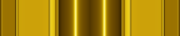

# Classic 확정 도안과 상태별 에셋 · 판정 연결 검토용

2026-10-25. 보존 원본 24개와 복사·상태별 생성물 306개, 총 330개 파일을 `assets/`에 묶었다. 이 묶음은 판정·렌더러 담당자가 적용 위치와 상태 대응을 검토하기 위한 자료다. 현재 `public/skins/classic/`, 스킨 로더, 판정 엔진은 변경하지 않는다.

`manifest.json`에는 각 파일의 크기·SHA-256·용도와 제안 스킨 키·런타임 경로를 적었다. `skinKey`와 `proposedRuntimePath`는 구현 제안이며 기존 API나 확정된 도메인 모델이 아니다. `source`는 제작 워크스페이스의 출처 기록이다. 이 묶음의 PNG·SVG는 모두 자체 포함 파일이며 해당 출처 경로나 Lab 갤러리 없이 열 수 있다.

## 확정 디자인

| 역할 | 싱글 | 더블 |
| --- | --- | --- |
| 누름 |  |  |
| 대기 바디 |  |  |
| 일반 릴리즈 J2-C |  |  |
| 유지 노트 D |  |  |

- 싱글 누름은 기존 디자인을 유지한다. 더블 누름은 **M6 아노다이징 대비 70%**다.
- 더블 바디는 바깥 면을 유지하고 중앙 영역만 넓혀 **42%·58%**에 두 광선을 둔다.
- **릴리즈도 마지막에 선택한 C안(J2-C)**으로 맞췄다. 초기 릴리즈 도안은 교체했다. `terminal-j2-shadow-3-{single,double}`에 보존된 선택 PNG를 `release-{single,double}.png`와 `@2x.png`로 바이트 그대로 복사한다. 릴리즈 SVG는 2배 PNG를 내장한 래퍼이며 벡터 원본이 아니다.
- **바디 시작·끝에는 별도 마감이 없다.** 시작에는 명시한 `Point`만, 끝에는 명시한 릴리즈만 추가한다. 릴리즈 없는 끝은 바디 자체로 끝난다. `terminal-j2-*`는 릴리즈 선택 원본의 출처 파일명이며 새 모델의 terminal 역할을 뜻하지 않는다([정정 댓글](https://github.com/nanana3679/not4k/pull/339#issuecomment-6390954414)).
- 유지 노트의 보존 원본은 **D 매듭 1.8배**이며, 이후 싱글은 **44px·어두운 윤곽선 안을 선택**했다. 아래 가독성 비교에서 선택본과 원본을 함께 확인한다. 싱글은 x=100, 더블은 x=84·116에 매듭을 둔다(200×40 기준). 투명 표식만 들어 있으므로 바디 위에 얹는다. 길이 0도 길이 0 바디 위에 같은 표식을 얹는 디자인이다.
- Grace는 실제 윤곽을 따르는 별도 overlay다. J2-C 원본의 모든 픽셀이 alpha 0.5 이상인 것을 검사하고, 그 **200×40 직사각 외곽 전체**에 검정 1px·흰색 1px·바깥 10px 번짐을 둔다. 더블 일부 실패도 반쪽이나 내부 이음선에 새 윤곽을 만들지 않는다.

## 파일과 제안 적용 경로

아래 목적지는 모두 `public/skins/classic/` 기준이다. 이번 PR에서 복사하거나 연결하지 않는다.

| 현재 파일 이름 | 제안 목적지 / 스킨 키 | 크기·배치 |
| --- | --- | --- |
| `note-single.png` | `note-single.png` / `noteSingle` | 212×40, 기존 유지 |
| `note-double-anodized-contrast-070.png` | `note-double.png` / `noteDouble` | 212×40 |
| `body-single.png` | `body-single.png` / `bodySingle` | 200×40 반복 타일 |
| `body-double-center-dual-beam.png` | `body-double.png` / `bodyDouble` | 200×40 반복 타일 |
| `terminal-j2-shadow-3-{single,double}.png` | 릴리즈 생성 입력만 보존, 런타임 키 없음 | 200×40, `@2x`는 400×80 |
| `release-{single,double}.png` | 같은 이름 / `releaseSingle`, `releaseDouble` 제안 | 200×40 |
| `release-{single,double}-failed.png` | 같은 이름 / `releaseSingleFailed`, `releaseDoubleFailed` 제안 | 200×40 |
| `release-double-partial-failed-{left,right}.png` | 같은 이름 / `releaseDoublePartialFailedLeft/Right` 제안 | 200×40, 실패한 절반만 무채색 |
| `sustain-{single,double}.png` | 같은 이름 / `sustainSingle`, `sustainDouble` 제안 | 200×40 투명 overlay |
| `point-grace-overlay.png` | 같은 이름 / `pointGraceOverlay` | 260×88, 본체 212×40, 좌상단 (24, 24) |
| `release-grace-overlay.png` | 같은 이름 / `releaseGraceOverlay` 제안 | 248×88, 본체 200×40, 좌상단 (24, 24) |
| `trill-grace-overlay.png` | 같은 이름 / 트릴용 별도 키 검토 | 248×88, 마름모 윤곽 |
| `terminal-grace-overlay.png` | 과거 참고본, 새 모델 키 없음 | 248×88, 새 바디에는 미사용 |

`*-grace.png`는 overlay를 본체에 합친 참고본이다. 실제 렌더러에서 별도 overlay를 사용할 경우 합성본을 다시 겹쳐 그리지 않는다. 일반 `@2x.png`는 400×80, Grace의 2배 PNG는 496×176이며 기본 PNG와 같은 논리 크기로 배치한다. 릴리즈·유지 SVG의 표시 크기는 200×40, 릴리즈 Grace SVG는 248×88이다. 다른 SVG는 기존 제작 좌표계를 보존하므로 개별 크기는 매니페스트를 따른다.

## 상태별 보완 · 검토 중인 시안

[판정 에이전트의 적용 계약](https://github.com/nanana3679/not4k/pull/339#issuecomment-6386397758)에 따라 자료를 보완했다. 이후 [성공·실패 표시 확인](https://github.com/nanana3679/not4k/pull/339#issuecomment-6390804166)과 [마감 제거 정정](https://github.com/nanana3679/not4k/pull/339#issuecomment-6390954414)을 우선한다. 새 상태의 구체적인 색·강도는 검토 중인 표현으로 구별한다. 실패색은 기존 릴리즈와 같은 **무채색·45% 밝기**를 참고한 시안이다.

| 도안 | 제공한 상태 | 표시 자료의 의미 |
| --- | --- | --- |
| 싱글 바디 | 대기, 전체 유지, 전체 실패 | 기존 싱글 도안 위에 유지·실패 처리를 적용 |
| 중앙 두 광선 더블 바디 | 대기, 전체 유지, 좌/우 미충족, 전체 실패, 좌/우 실패 | 광선 중심 x=84·116 유지. 미충족 쪽은 대기색, 충족 쪽만 흰 코어. 실패한 쪽은 무채색 |
| J2-C 릴리즈 | 싱글 정상·전체 실패, 더블 정상·전체 실패·좌/우 실패, 일반/Grace 성공 단계 | 일부 성공은 본체 전체 70%. Grace 외곽 100% 유지. 모두 성공하면 본체·외곽 숨김 |
| M6 더블 누름 | 미처리, 전체 실패, 좌/우 일부 처리 | 일부 처리 자료도 일반 더블 `Point`의 일부 성공과 같은 정상 그림 + 전체 alpha 0.7로 표시. 두 기존 일부 실패 키가 정상 그림을 공유하는 제안이며 바디의 좌/우 실패 그림과 다름 |
| D 유지 표식 | 싱글 전체 실패, 더블 전체 실패·좌/우 실패 | 정상 매듭의 좌표·투명 여백 유지. 별도 켜짐/Grace/트릴 유지 도안 없음 |
| 릴리즈·유지 몫별 레이어 | 더블 좌/우 정상, 좌/우 실패를 각각 분리 | 기본 PNG는 두 레이어를 합치면 원본과 일치. 릴리즈 일부 성공의 반쪽 숨김은 전체 70%로 대체. 유지 및 성공·실패 혼합의 합성은 별도 검토 |
| 몫별 마스크 | 왼쪽, 오른쪽 200×40 알파 마스크 | 잘라낸 절반도 전체 바디 좌표를 유지하며 x 위치를 다시 중앙 정렬하지 않음 |

모든 새 시안은 기본 PNG·2배 PNG·SVG를 제공한다. 기본 크기는 바디·릴리즈·유지 200×40, M6 누름 212×40이다. 분리 레이어의 기본 PNG는 승인 PNG의 픽셀을 그대로 나누고, 유지의 2배 PNG와 SVG는 벡터 원본을 사용하고, 릴리즈는 J2-C 2배 PNG를 내장한 SVG에서 만든다. 매니페스트의 `stateGroups`에 상태별 파일·공유 관계·미충족 방향을 기록했다. `PartialHeldLeft/Right`는 **미충족 쪽**, `PartialFailedLeft/Right`는 **실패한 쪽**이다. 물리 키나 손 소유권을 뜻하지 않는다.

새 상태 파일은 `body-double-held`, `body-double-partial-held-{left,right}`, `body-double-failed`, `body-double-partial-failed-{left,right}`, `note-double-failed`, `sustain-{single,double}-failed`, `sustain-double-partial-failed-{left,right}`, `{sustain,release}-double-unit-{left,right}[-failed]`, `unit-mask-{left,right}` 이름으로 찾을 수 있다.

## 재생성 및 미리보기

### 릴리즈 전체 구성 · 넓은 면과 끝 띠

릴리즈만 디자인이 복잡해 통일감이 없다는 피드백에 따른 전체 형태 시안이다. `#release-simple-frame`은 중앙 방패형 홈·분할된 옆면·떠 있는 빛띠를 덜고, 포인트·바디처럼 넓은 면 하나와 끝부분 띠로 정리한 싱글·더블을 수평 접점 안과 비교한다. 기존 포인트·바디에 연결한 대기/활성 및 게임 크기도 확인한다. 새 형태는 미선택이며 기존 시안을 대체하지 않는다.

내장 `image_gen.imagegen`에 현재 릴리즈를 수정 대상으로, 포인트·바디를 면 구성·재질 참고로 제공했다. 파란 시안을 먼저 만든 뒤 같은 형태의 금색 대응을 생성했다. 원본·색 보정 단계·[전체 프롬프트](simple-frame-reference/prompts.json)를 보존한다. `release-simple-frame.mjs`가 [crop·정렬 좌표](simple-frame-reference/geometry.json)에 따라 200×40으로 내보내며 광선 끝 흰빛을 싱글 x=100·더블 x=84/116에 맞춘다. 선택한 촘촘한 3단 10% 확대 벡터를 그대로 합성하므로 경로·위치·100/80/50 알파는 유지한다.

`release-{single,double}-simple-frame` PNG·2배 PNG·SVG 6개와 `manifest.releaseSimpleFramePreview`를 추가한다. 이전 324개 에셋·실제 스킨·판정 연결은 그대로 둔다.

### 릴리즈 접점 · ㅡ 수평 연결

사용자 요청에 따라 접점의 위로 꺾이는 짧은 경계를 없애고 `ㅡ` 수평 연결로 단순화했다. `#release-horizontal-junctions`에서 직전 꺾임 안과 싱글·더블의 전체·접점 확대·바디 연결·게임 크기를 비교한다. 면의 밝기 차이로 단차를 드러내며 기존 색과 테두리 폭, 중앙 화살표·광선 끝 흰빛은 유지한다.

내장 `image_gen.imagegen`으로 변형 전 원본 crop의 가로 경계를 같은 높이로 안쪽 테두리까지 연결했다. [생성본·전체 프롬프트](horizontal-junction-reference/prompts.json)와 [정렬 좌표](horizontal-junction-reference/geometry.json)를 보존한다. 기존 직선 보호 합성을 재사용하며 수평선 높이는 원본의 밝은 경계와 맞춘다(400×80 기준 싱글 y=46.5, 더블 y=47.5). 새 가지가 생기거나 원래 긴 테두리가 휘지 않도록 접점 안쪽만 합성한다.

`release-{single,double}-horizontal-junctions` PNG·2배 PNG·SVG 6개와 `manifest.releaseHorizontalJunctionPreview`를 추가한다. 이전 318개는 보존하며 실제 스킨 연결은 별도다.

### 릴리즈 주변 면 · 원본 폭과 직선 복원

세 면의 꼭짓점은 맞지만 주변 공간이 찌그러졌다는 피드백을 반영했다. `#release-straight-junctions`는 원본 바디 팔레트 릴리즈(더블은 두 광선 끝 흰빛 포함) 위에서 꼭짓점 안쪽 면만 새로 합성한다. 긴 대각선 테두리·가로 흰 띠·y≥49의 아래 사선은 원본 픽셀을 사용한다. 직전 안과 전체·접점 확대·바디 연결·게임 크기로 비교하고 변형 전 원본도 펼쳐 확인한다.

내장 `image_gen.imagegen`에 변형 전 원본 crop을 수정 대상으로, 직전 시안을 꼭짓점 구조만 참고하는 자료로 주었다. [입력·생성본·프롬프트](straight-junction-reference/prompts.json)를 보존한다. `release-straight-junctions.mjs`는 원본 직선 안쪽으로 합성 범위를 제한한다. 400×80 기준 y=30～49, 왼쪽 x=82부터 원본 밝은 테두리 직전까지만 바꾸고 오른쪽은 대칭으로 적용한다. 생성 crop의 위치 보정과 테두리 보호 직선은 `straightJunctionGeometry`에 기록한다. 중앙 도안·광선 끝 흰빛·알파와 범위 밖 픽셀은 원본 그대로다.

`release-{single,double}-straight-junctions` PNG·2배 PNG·SVG 6개와 `manifest.releaseStraightJunctionPreview`를 추가한다. 이전 312개는 보존한다. 실제 스킨 연결은 별도다.

### 릴리즈 세 면의 꼭짓점 · 기존 교차 사선 제거

이 시안은 꼭짓점은 맞지만 주변 면이 찌그러졌다는 사용자 확인을 받았다. `#release-straight-junctions`에서 원래 폭과 직선을 복원한다. 앞면·윗면·옆면의 경계 세 개가 한 꼭짓점에서 만나는 구조다. 직전 분기 시안에는 위·바깥쪽으로 향하는 기존 사선이 남아 X처럼 보였다. `#release-clean-junctions`에서 그 사선과 붙어 있던 밝은 테두리를 지운 싱글·더블을 직전 안과 비교한다. 새 상승 경계, 아래로 이어지는 경계와 수평 경계는 유지한다.

내장 `image_gen.imagegen`으로 확대 접점의 기존 선을 제거했다. [생성 원본·입력 crop·전체 프롬프트](clean-fork-reference/prompts.json)를 보존한다. `release-clean-junctions.mjs`는 400×80 기준 왼쪽 x=82～109·오른쪽 x=291～318, y=26～50 안의 기존 사선 주변만 부드럽게 합성한다. 오른쪽은 같은 생성 crop을 반전해 사용하며 범위 밖 픽셀과 전체 알파는 직전 시안 그대로다. 중앙 화살표·광선 끝 흰빛·외곽을 보존한다.

`release-{single,double}-clean-junctions` PNG·2배 PNG·SVG 6개와 `manifest.releaseCleanForkPreview`를 추가한다. 앞선 306개 에셋은 변경하지 않는다. 실제 스킨·실패·Grace 적용은 별도다.

### 릴리즈 아래 접점 · 기존 사선이 남은 분기

이 분기 시안은 기존 사선을 지우지 않아 X처럼 보인다는 사용자 확인을 받았다. 수정본은 `#release-clean-junctions`에 둔다. 그 전 시안은 흰 띠의 끝만 사선으로 바뀌었고 아래 접점은 갈라지지 않았다. 사용자 지적을 반영해 `#release-forked-junctions`에서 **흰 띠 아래 수평 경계의 끝**을 다시 수정한다. 400×80 기준 왼쪽 약 (99, 47), 오른쪽 약 (301, 47)에서 위로 올라가는 짧은 경계와 아래로 내려가는 경계를 나누고 그 사이 옆면이 보이게 한다. 싱글·더블 모두 직전 안과 실제 PNG·SVG 확대, 바디 연결, 게임 배율로 비교한다.

내장 `image_gen.imagegen`에 색 수정 원본과 실제 접점에 세 방향을 그린 가이드를 주었다. 생성 원본·프롬프트·가이드는 [`fork-reference/`](fork-reference/)에 보존한다. `release-forked-junctions.mjs`는 하단 접점 영역만 합성하며(400×80 기준 왼쪽 x=87～130, 오른쪽 x=270～313, y=32～79), 생성본의 접점을 맞추기 위해 crop 뒤 좌우로 싱글 2px·더블 5px를 반대 방향으로 이동한다. **y<32의 흰 띠, 중앙 화살표와 광선 끝 흰빛, 그 밖의 픽셀·알파는 원본을 유지**한다. 같은 생성 이미지를 SVG 내부 참조로 두 접점에서 재사용한다.

`release-{single,double}-forked-junctions` PNG·2배 PNG·SVG 6개와 `manifest.releaseForkPreview`를 추가한다. 앞선 300개 파일은 보존하며 `releaseJunctionPreview.feedback`에 직전 시안의 미충족 사항을 기록한다. 실제 스킨·실패·Grace 연결은 별도다.

### 직전 릴리즈 시안 · 흰 띠 끝 사선

`#release-stepped-junctions`는 위치·구조 확인 후 처음 만든 시안의 기록이다. **의도와 달리 흰 띠 끝만 바뀌었고 아래 접점의 분기는 만들지 못했다.** 전체 도안, 좌우 접점 확대, 바디 연결, 게임 배율 대기/활성은 과거 비교로 보존하며 새 수정안은 `#release-forked-junctions`에서 확인한다.

내장 `image_gen.imagegen`에 각 색의 현재 도안과 확인한 설명 그림을 주었다. 전체 프롬프트·생성 원본·설명 그림·정렬 crop은 [`junction-reference/`](junction-reference/)에 보존한다. `release-stepped-junctions.mjs`는 생성본의 두 접점 주변만 부드럽게 합성한다(400×80 좌표: 왼쪽 x=82～127, 오른쪽 x=273～318, y=22～66). 그 밖의 원본 픽셀과 전체 알파를 보존하며 기본 PNG는 기본 원본, 2배 PNG·SVG는 2배 원본을 사용한다.

`release-{single,double}-stepped-junctions`의 PNG·2배 PNG·SVG 6개와 `manifest.releaseJunctionPreview`를 추가한다. 앞선 294개 에셋은 그대로 보존하며 새 도안의 실제 스킨·실패·Grace 파생본 적용은 별도다.

### 릴리즈 접점 · 단차 해석 확인

`#release-junction`은 사용자의 `-\` → `-<` 피드백에서 확인한 위치·구조를 기록한 설명 그림이다. 양옆 가로 띠가 중앙 경사 테두리에 닿는 두 접점(400×80 기준 x=104·296, y=42)을 수정 전 더블 도안 위에 표시하고, 경계 하나가 이어지는 경우와 위·아래 경계가 갈라져 짧은 옆면을 만드는 경우를 개념도로 비교한다. `release-junction.mjs`의 HTML/SVG 주석이며, 실제 수정안은 위의 `#release-horizontal-junctions`에서 확인한다.

### 더블 릴리즈 · 두 광선 끝에 흰빛 맞추기

`#release-beam-ends`는 사용자가 확인한 바디 기준 릴리즈 색을 유지하고 더블의 중앙 흰빛 한 지점을 **광선 x=84·116에 맞춘 두 지점**으로 나눈 비교다. 두 화살표 아래의 얇은 띠는 이어지고 x=100에는 별도 밝은 중심을 두지 않는다. 싱글의 한 지점은 기존 그대로다. 수정 전·후를 확대, 활성 바디 연결, 게임 배율 대기/활성으로 확인한다.

내장 `image_gen.imagegen`으로 바디색 더블 릴리즈의 하단 빛만 수정했다. 전체 프롬프트·생성 원본·정렬 crop은 [`beam-end-reference/`](beam-end-reference/)에 보존한다. `release-beam-ends.mjs`는 생성본에서 중앙 하단 띠(400×80 좌표의 x=130～270, y=52～77)만 가장자리를 부드럽게 합성하고, 나머지 원본 픽셀과 3단 표식·알파를 유지한다. `release-double-palette-body-dual-ends` PNG·2배 PNG·SVG 3개와 `manifest.releaseBeamEndPreview`를 추가하며 앞선 291개는 그대로 보존한다. 새 도안의 실제 스킨·실패·Grace 파생본 적용은 별도다.

### 릴리즈와 바디만 색 맞추기

`#release-body-color`는 재질 수정 방향을 보류하고 원래 J2-C의 색만 바디에 맞춘 비교다. 기존 `paletteAnchorPreview`의 `original`에서 포인트·대기 바디·활성 바디를 가져오고, 후보 릴리즈만 `body`의 `release-{single,double}-palette-body`를 재사용한다. 앞선 바디 기준안과 달리 포인트는 원래 색을 유지한다. 넓은 중앙 면 어둡게 하기·셀채색·흰빛 알파 수정은 이 조합에 적용하지 않는다.

싱글·더블의 원래 릴리즈와 후보를 확대, 활성 바디 연결, 게임 배율 대기/활성으로 비교한다. 기존 색 변환의 명암·알파 보존과 선택한 3단 표식을 그대로 사용하며 새 에셋을 만들지 않는다(총 291개). 원래 릴리즈 및 후보의 PNG·2배 PNG·SVG를 내려받을 수 있다. 후보는 미선택이고 실제 스킨 연결은 별도다.

### 넓은 중앙 면 · 흰빛 레이어 알파

`#release-material-corrected`는 "가는 선이 아니라 넓은 부분을 어둡게", "5번은 흰 영역을 좁히지 말고 흰빛만 알파를 낮추기"라는 정정을 반영한 후속 시안이다. **넓은 부분은 꺾쇠 뒤 중앙 바탕면 전체로 해석**했다. 기존 번호 1에 해당하는 면까지 바디의 광선 주변 색으로 어둡게 하며 4번 명암 면은 직전 생성 참고를 재사용한다. 싱글은 바디 (92, 20), 더블은 (100, 20)의 색을 사용하고 원래 중앙 면의 밝기 차이는 좁은 어두운 범위 안에 남긴다. 원래 꺾쇠 경로·중심·100%·80%·50%는 다시 합성한다. 이 면 범위와 강도는 미선택 시안이다.

J2-C는 흰빛까지 합쳐진 PNG라 원래 흰빛 레이어가 존재하지 않는다. `release-highlight.mjs`는 5번 아래 인접 면의 색으로 흰빛 아래 바탕을 추정한 후, 원본 색을 재구성하는 source-over 레이어를 계산한다. 이는 숨겨진 원본 레이어 복원이 아닌 보정용 분리다. 세 안은 **동일한 바탕·흰빛 이미지·크기·위치·클립**에 흰빛 `opacity` **1·0.5·0**만 적용한다. SVG `atop` 합성은 에셋 전체의 알파를 보존한다. 0%는 추정 바탕을 확인하는 진단용이며 50%를 비교 중심으로 둔다. 새로운 ImageGen 호출은 하지 않는다.

`release-{single,double}-material-wide-light-{100,050,000}`의 PNG·2배 PNG·SVG **18개**를 추가한다. `manifest.releaseWideMaterialPreview`에 조합과 바디에서 가져온 색을 기록한다. 갤러리는 같은 포인트·바디 연결, 게임 배율 대기/활성과 펼쳐 보는 원본·직전 시안을 제공한다. 이전 273개 파일은 그대로 유지하며 실제 스킨·실패·Grace 적용은 별도다.

### 릴리즈 3·4·5번 재질 수정

`#release-material`에서 기존 릴리즈와 3·4·5번을 수정한 시안을 싱글·더블로 비교한다. **3번 U자 빛줄기는 바디 광선 주변 같은 어두운 홈**, **4번 윗면은 밝은 면·중간 면·그늘 면으로 명암을 나눈 셀채색**, **5번 가로빛은 강도를 낮춘 선**으로 표현한다. 4번 전체를 단색으로 채우지 않는다. 같은 기존 포인트·바디를 사용해 확대, 활성 바디 연결, 게임 배율 대기/활성을 보여 준다.

내장 `image_gen.imagegen`에 원래 릴리즈를 편집 대상으로, 해당 바디를 재질·색 참고로 주었다. 생성 원본과 전체 프롬프트는 [`material-reference/`](material-reference/)에 보존한다. 생성본의 달라진 꺾쇠·중앙 면 등은 채택하지 않는다. `release-material.mjs`가 기록된 crop으로 검정 여백을 제외하고 3·4·5번 영역만 원래 400×80 좌표계에 합성한다. 중앙 꺾쇠·하단 면·양끝 띠를 비롯한 영역 밖 픽셀은 원본을 사용하며 8번 흰빛의 코어는 마스크로 보존하고 주변을 부드럽게 연결한다. SVG의 `atop` 합성으로 원본의 픽셀별 알파도 유지한다. 이 영역 구분은 미리보기 제작용이며 런타임 레이어 계약이 아니다.

`release-{single,double}-material-body` PNG·2배 PNG·자체 포함 SVG **6개**를 추가한다. 기본 PNG는 원래 기본 PNG 위에, 2배 PNG·SVG는 원래 2배 PNG 위에 합성한다. `manifest.releaseMaterialPreview`에 원본·후보·포인트·바디 조합을 기록한다. 앞선 267개 에셋은 바이트 그대로 유지하며 새 시안은 미선택이다. 실제 스킨 연결과 실패·Grace 파생본 적용은 별도다.

### 릴리즈 부위 번호

`#release-parts`는 색·재질 피드백을 위한 부위 안내다. 원래 색의 `release-{single,double}-chevron-triple-tight-large@2x.png` 위에 번호와 지시선을 얹고, 번호 없는 같은 원본을 함께 보여 준다. 1 중앙 바탕면, 2 3단 꺾쇠, 3 중앙 테두리 빛, 4 양옆 윗면, 5 양옆 가로 빛, 6 양옆 아랫면, 7 양끝 세로 띠, 8 중앙 아래 흰빛으로 구분한다. 싱글·더블과 좌우 대칭 부위는 같은 번호다.

번호 선택 시 두 그림의 해당 영역이 함께 강조되며 전체 보기로 돌아갈 수 있다. 선택은 키보드 방향키로도 가능하다. `release-parts.mjs`가 원본 좌표계의 설명용 영역·지시선과 HTML·CSS를 제공한다. 시각 부위 구분이며 새 스킨 레이어 계약이 아니다. 원본 에셋·팔레트 선택·매니페스트 파일 수는 바꾸지 않는다.

### 유지 표식 가독성 · 광선 홈 폭 + 윤곽선 시안

`#sustain-visibility`에서 기존 D 매듭과 확대안을 싱글·더블, 바디 대기·활성, 게임 배율로 비교한다. 기존 27.36px 폭에서 윤곽 포함 싱글 36px·더블 각 32px로 키운다. 원래 가로세로 비율을 유지하며 광선 중심 x=100 또는 x=84·116에 놓는다. 싱글은 바로 바깥 파란선(x=78·122)까지 닿는 44px 안도 비교한다. 같은 비율로 키워 윤곽 포함 높이는 약 39.6px이며, 모든 안이 40px 캔버스 안에 들어간다. 더블의 두 매듭은 각 32px를 유지한다.

표식의 실제 외곽을 따라 2.4px 어두운 선을 둔다(싱글 `#05243a`, 더블 `#3b2906`). 빛번짐·Grace 효과가 아닌 가독성용 윤곽선이다. 바디와 표식 면 색은 그대로다. `sustain-visibility.mjs`가 기존 SVG의 D 경로를 재사용하며 `sustain-{single,double}-channel-outline`와 `sustain-single-rail-outline`의 PNG·2배 PNG·SVG 9개를 생성한다.

`manifest.sustainVisibilityPreview`에 비교 원본·후보·표시 폭·활성 바디를 기록한다. **싱글 44px는 사용자 선택본**으로 `selected.single`에 기록한다. 더블 32px는 시안이며 기존 정상본·실패본·몫별 레이어와 런타임 키를 교체하지 않는다. 게임 배율은 누름 폭 62.5px를 기준으로 바디와 overlay를 함께 `62.5 / 212`로 줄인다.

### 포인트 고정 · 중간 강도 2안

`#palette-balance`는 세 기준안에 대한 사용자 피드백(포인트 기준은 칙칙함, 릴리즈 기준은 쨍함, 바디 기준은 포인트 변화가 큼)을 반영한 비교다. 싱글·더블 포인트는 기존 PNG를 그대로 쓰며 바디·릴리즈만 앞선 포인트 팔레트와 원색 사이로 조절한다. 기준 3안은 선택하지 않은 비교 기록으로 보존하고 `paletteAnchorPreview.feedback`에 반응을 기록한다.

- **A · 원색을 더 살림:** 바디 대기/활성은 색 변환 20% + 원본 80%, 릴리즈는 색 변환 45% + 원본 55%.
- **B · 색 차이를 더 줄임:** 바디 대기/활성은 색 변환 35% + 원본 65%, 릴리즈는 색 변환 65% + 원본 35%.

SVG 색 변환 뒤 `SourceGraphic`과 sRGB에서 혼합한다. 본체 전체를 투명하게 만드는 처리가 아니며 알파·명암 배치를 보존한다. 릴리즈 3단은 혼합 필터 밖에 원래 도형·색·단계별 불투명도로 합성한다. `paletteMappedArtwork`의 기본 `amount=1`은 이전 출력과 같다.

`{body,body-held,release}-{single,double}-balance-{gentle,unified}`의 PNG·2배 PNG·SVG 36개를 제공한다. `manifest.paletteBalancePreview`에 같은 포인트 원본과 조합별 파일·변환 비율을 기록한다. 기본 크기와 게임 배율의 바디 대기/활성에서 기존 조합과 A/B를 비교하며 모든 출력에서 알파 일치·sRGB 혼합값 오차 3/255 이내·sRGB 가중 밝기 오차 3/255 이내를 확인한다. 이 수치는 선형광 휘도나 지각 명도 보장을 뜻하지 않는다. 두 안 모두 미선택 시안이며 실제 게임 적용과 상태 파생본은 별도다.

### 팔레트 기준 3안 · 포인트 / 릴리즈 / 바디

`#palette-anchors`에서 기존 조합과 세 기준안을 싱글·더블로 비교한다. 각 기준 에셋은 원본 파일을 그대로 사용하며 나머지 두 역할만 같은 색 변환으로 맞춘다. 포인트 기준은 앞선 ImageGen 색 참고를 바디까지 확장하고, 릴리즈 기준은 기존 J2-C 원본, 바디 기준은 기존 대기 바디에서 색을 직접 추출한다. 새 이미지 생성 없이 기존 SVG 색 변환을 재사용한다.

- **포인트 기준:** 기존 포인트 + 앞선 릴리즈 색안 + 같은 팔레트의 바디 대기/활성.
- **기존 릴리즈 기준:** 기존 3단 릴리즈 + J2-C 팔레트로 맞춘 포인트와 바디 대기/활성.
- **기존 바디 기준:** 기존 바디 대기/활성 + 대기 바디 팔레트로 맞춘 포인트와 릴리즈.

전체 연결의 기본 크기와 게임 배율 대기/활성을 보여 주며 각 조합에서 포인트·바디 대기·바디 활성·릴리즈를 내려받는다. 포인트는 212×40, 바디·릴리즈는 200×40이다. `manifest.paletteAnchorPreview`에 조합별 원본·후보를 기록한다. `note-{single,double}-palette-{release,body}`, `body-{single,double}-palette-{point,release}`, `body-held-{single,double}-palette-{point,release}`, `release-{single,double}-palette-body`의 PNG·2배 PNG·SVG **42개**를 추가하며 앞선 릴리즈 후보 6개를 재사용한다.

`paletteMappedArtwork`는 입력 SVG의 좌표계를 유지하면서 목표 폭·높이로 배치한다. 기본 PNG는 원래 기본 PNG에서, 2배 PNG·SVG는 원래 SVG에서 생성하며 릴리즈는 J2-C 원본에서 변환한 뒤 동일한 3단을 얹는다. 브라우저에서 새 42개 출력의 sRGB 가중 밝기 오차 3/255 이내와 알파 오차 1/255 이내를 확인한다. 알파를 의도적으로 바꾸지 않으며 반투명 외곽의 래스터 반올림만 허용한다. 기준 에셋이 동일 파일인지와 1024·768·390px 폭의 배치도 검증한다. 세 기준은 모두 미선택 시안이며 실패·Grace 파생본이나 런타임을 교체하지 않는다.

### 릴리즈 팔레트 · 포인트 색과 연결

`#release-palette`에서 선택한 촘촘한 3단 릴리즈의 이전 색과 포인트 팔레트에 맞춘 색을 비교한다. 싱글은 청록 발광을 옅은 하늘색으로, 더블은 샛노랑 발광을 크림 골드로 옮긴다. 같은 포인트·바디에 연결한 기본 크기, 게임 배율의 대기/활성 바디, 릴리즈 확대와 PNG·2배 PNG·SVG 다운로드를 제공한다. 후보 `release-{single,double}-palette-point` 6개는 미선택 시안이며 기존 상태별 에셋과 런타임을 교체하지 않는다.

내장 `image_gen.imagegen`에 기존 J2-C 릴리즈를 편집 대상으로, 포인트와 바디를 색 참고로 주었다. 생성본은 내부 경계까지 조금 달라져 도안으로 사용하지 않는다. 원본과 전체 프롬프트는 [`palette-reference/`](palette-reference/)에 보존하며 공개 갤러리에는 최종 후보만 복사한다.

`release-palette.mjs`는 생성본의 불투명 픽셀에서 밝기별 RGB 색을 추출하고 65개 색 변환 표를 만든다. 입력의 **sRGB 가중 밝기**(`0.2126R + 0.7152G + 0.0722B`)에 맞춰 색차를 이동하고 색역 밖 성분은 중립색 방향으로 줄인다. 이는 선형광 휘도나 지각 명도를 일치시킨다는 뜻이 아니다. 원래 J2-C에 SVG 필터로 표를 적용하므로 외곽·반사 위치·명암 배치를 보존하며 알파를 바꾸지 않는다. 선택한 3단 표식은 필터 바깥에 같은 도형·색·100%·80%·50%로 합성한다.

기본/2배 PNG와 SVG의 실제 픽셀에서 알파 일치, 브라우저의 8비트 필터·표식 합성 반올림을 포함한 sRGB 가중 밝기 오차 3/255 이내, 기존 표식 도형 일치를 검증한다. `manifest.releasePalettePreview`에 전후 파일·기준 포인트·바디를 기록하고 후보 생성 기록에는 참고 이미지의 SHA-256을 남긴다.

### 릴리즈 중앙 꺾쇠 · 3단 투명도 시안

`#release-symbol`에서 사용자가 선택한 촘촘한 3단의 확대 전·10% 확대를 비교한다. `selectedVariant`는 `triple-tight-large`다. 꺾쇠의 중앙은 바디 상태 그룹의 `beamCenters`를 그대로 공유한다. 싱글은 x=100, 더블은 x=84·116이며 위치를 눈대중으로 옮기지 않는다. 갤러리의 “광선 중심선 보기”로 아이콘과 실제 바디를 관통하는 기준선을 켤 수 있다.

3단의 경로 폭은 14px, 한 줄의 상승 높이는 4.5px, 선 두께는 2.2px다. 위부터 alpha **1 → 0.8 → 0.5**이며 각 꺾쇠의 본체와 윤곽선을 함께 흐리게 한다. 윤곽은 한쪽 0.6px·불투명도 55%로 가볍게 하고 선 끝과 꼭짓점을 둥글게 한다. `triple-fade`는 중심선 간격 6px, `triple-tight`는 5px로 보존한다. 선택본 `triple-tight-large`는 촘촘한 안의 경로·선·윤곽을 1.1배로 키운 것으로, 경로 폭 15.4px·상승 높이 4.95px·중심선 간격 5.5px·선 두께 2.42px·한쪽 윤곽 0.66px다. 아이콘 중심과 단계별 알파는 유지한다.

기존 2단은 동일한 진한 외곽선이 겹쳐 작은 계급장처럼 보이고, 두 표식 사이의 릴리즈 원본 하이라이트와 시선을 나누는 문제가 있었다. 새 시안은 아래로 흐려지는 단계와 좁은 폭으로 위쪽 방향을 강조한다. 원본 도안의 중앙 하이라이트는 바꾸지 않는다.

기존 `thin`·`bold`·비율 A/B/C 파일은 그대로 보존한다. [처음 참고한 이중 꺾쇠](https://lucide.dev/icons/chevrons-up)의 방향성을 유지하며 직접 그린 도형을 조정한다.

`release-chevron.mjs`가 기존 PNG를 내장한 SVG에 벡터 표식을 합성한다. 중앙 외의 도안과 200×40 크기를 보존하고, 기본 PNG에는 기본 원본을, 2배 PNG·SVG에는 2배 원본을 사용한다. `release-{single,double}-chevron-{thin,bold,ratio-a,ratio-b,ratio-c,triple-fade,triple-tight,triple-tight-large}`의 PNG·2배 PNG·SVG 48개를 제공하며 활성 바디 끝과 게임 배율로 확인한다.

`manifest.releaseSymbolPreview`에 비교 순서·파일·선 두께·기하 수치·단계별 알파·아이콘 중심을 기록한다. 촘촘한 3단의 확대본을 선택안으로 기록하며 기존 릴리즈 정상·실패·Grace·몫별 레이어와 런타임 키 교체는 별도 적용이다.

### 바디 위 더블 포인트 일부 성공

갤러리의 `#point-success`에서 선택한 M6 도안에 일반 더블 `Point`의 표시 alpha **1 → 0.7 → 0**을 적용한다. 단색 배경과 실제 더블 바디 위에 대기·일부 성공·모두 성공을 나란히 표시한다.

- 포인트는 212×40, 바디는 200×40이다. 중심을 맞춰 포인트가 바디 양옆으로 6px씩 나오며 바디는 alpha 1로 유지한다.
- `manifest.pointSuccessPreview`에 원본·표시 크기·바디 크기·알파·배경을 기록한다. M6의 재질 대비 70%와 일부 성공 표시 알파 70%는 별개다.
- 기존 상태 목록의 누름 일부 처리도 70%로 맞춘다. 정상 PNG를 재사용하며 실제 게임 표시와 판정은 변경하지 않는다.

### 일반·Grace 릴리즈의 성공·실패 표시

[사용자 확인을 전달한 댓글](https://github.com/nanana3679/not4k/pull/339#issuecomment-6390804166)에 따라 `#release-success`에서 확정한 일반·Grace 성공 단계를 비교한다. `manifest.releaseSuccessPreview`에 원본·목표 크기·표시 알파·배경을 기록했다.

- 일반 릴리즈는 같은 `assets/release-double.png`에 본체 alpha **1 → 0.7 → 0**을 적용한다. 대기 → 일부 성공 → 모두 성공 숨김이며 200×40 위치·모양·색을 유지한다. 앞선 50%·반쪽 숨김 제안을 대체한다.
- Grace도 본체 alpha **1 → 0.7 → 0**, 별도 전체 외곽 alpha **1 → 1 → 0**이다. 일부 성공에서 외곽은 원래 밝기를 유지하고, 모두 성공하면 함께 숨긴다. `release-grace-overlay.png`를 한 번만 올리며 반투명 PNG를 추가하지 않는다.
- 각 단계를 단색 배경과 실제 더블 바디 위에서 비교한다. 바디는 alpha 1로 유지한다. 외곽은 248×88, 본체는 패딩 24px 안의 200×40이다.
- **실패 확정된 릴리즈는 실패색으로 표시하고 스크롤되어 화면 밖으로 나갈 때까지 남긴다.** 바디 실패로 입력 기회를 잃은 종속 0점도 포함한다. 판정 가능·유예 대기 상태를 먼저 실패색으로 바꾸지 않는다. 이는 시각적 잔류이며 새로운 Miss·콤보·고도 이벤트를 만들지 않는다.
- 일부 성공과 실패가 함께 확정된 더블의 최종 합성 및 유지 노트의 표시 방식·수명은 별도 검토다. 실패색의 구체적인 강도도 시안으로 남긴다. 이번 갤러리는 정적 자료이며 실제 게임의 스크롤·판정에 아직 연결하지 않는다.

### 별도 마감 없는 바디 시작·끝

`#body-boundaries`에서 같은 200×160 바디에 `Point` 없음/있음 × 릴리즈 없음/있음 네 조합을 비교한다. 위가 끝, 아래가 시작이며 바디의 경계는 모든 조합에서 같다. 시작 `Point`는 212×40, 끝 릴리즈는 200×40이고 각 노트의 세로 중심을 해당 경계에 맞춘다.

시작 마감 반전·끝 마감·terminal 상태 그룹과 새 모델 terminal 스킨 키를 제거했다. 마감용으로 생성했던 실패 파생 파일 12개도 묶음·갤러리에서 제거했다. J2-C 선택 원본과 과거 `terminal-grace-overlay`는 각각 `release-source`·`historical-reference`로 보존하며 런타임 키를 제안하지 않는다. 바디 구간의 병합이나 암묵적인 `Point`·릴리즈 추가는 하지 않는다.

### 생성 명령

```sh
node assets-lab/classic/revisions/approved-notes-20261025/build-states.mjs
node assets-lab/classic/revisions/approved-notes-20261025/build-preview.mjs
pnpm build:lab
```

`build-states.mjs`는 이 묶음 안의 확정 원본만 읽는다. `state-artwork.mjs`는 SVG 필터·클립·흰 코어로 상태를 만들고, 출력할 때 **목표 크기를 직접 지정**한다. 기존 빌더의 SVG 자연 크기 ÷ 5 규칙을 쓰지 않으므로 200×40인 유지 SVG가 40×8로 줄어들지 않는다. J2-C 릴리즈 정상본은 기본·2배 PNG를 그대로 복사하고, 실패·일부 실패·분리 레이어·Grace는 같은 원본에서 재생성한다. 보존 원본 24개는 재생성하지 않는다.

더블 릴리즈·유지의 실패 몫 SVG는 정상 원본에 실패색과 좌우 클립을 한 번에 적용한다. 이미 생성한 실패 SVG를 다시 감싸면 내부 ID가 중복되어 투명하게 렌더링될 수 있다. 단위 테스트로 SVG별 ID 중복을 검사하고, 브라우저 테스트로 실패 몫의 SVG·2배 PNG에 표식이 보이며 반대편 알파는 0인지 확인한다. 기본 PNG의 좌우 재합성 검사도 유지한다.

`build-preview.mjs`가 `/lab/images/classic-approved-states-20261025/` 비교 화면과 다운로드 파일을 만든다. 마감 없는 바디 경계·길이 0 바디+유지, 일반/Grace 성공 단계, 실패 상태와 참고용 몫별 레이어를 확인할 수 있다. 확정한 실패 잔류를 실제 스크롤에 연결하는 검증은 새 모델 구현에서 진행한다.

## 실제 연결 담당자에게 전달할 사항

- 런타임 목적지는 위 대응표의 `public/skins/classic/`다. SVG 생성 원본과 J2-C PNG 복사 경로를 `states.mjs`·`build-classic-skin.ts`에 함께 연결해야 재생성으로 옛 그림이 돌아오지 않는다. 이번 PR에서는 현재 게임 파일을 바꾸지 않는다.
- 유지·릴리즈는 명시적인 노트 진입점에서 자기 시각의 세로 가운데에 놓는다. 바디 200×40 좌표계를 쓰고 누름의 212×40 전체 폭으로 늘리지 않는다. Grace 여백 24px도 본체 배율과 함께 줄인다.
- 바디 시작·끝에는 별도 terminal을 그리지 않고, 바디·유지에는 Grace를 붙이지 않는다. `terminal-grace-overlay`는 과거 표현의 참고 자료다. `*-grace.png` 합성 참고본과 별도 overlay를 중복해서 겹치지 않는다.
- 바디+Point는 가능하지만 같은 위치의 Point+릴리즈·Point+유지·릴리즈+유지는 금지다. 길이 0 유지 시연에는 바디와 표식만 둔다. 트릴 위 유지와 연결점의 허용 조건은 위 판정 계약을 따른다.
- 바디 완료, 각 릴리즈·유지 몫의 미처리/성공/실패/종속 0점을 구별한다. 릴리즈의 일부 성공은 전체 70%, 모두 성공은 숨김이다. 유지 노트의 표시 방식은 별도 검토다. 일부 실패와 성공·실패 혼합은 구별한다. 실패 이미지의 존재가 입력 기회 유지나 새 Miss를 뜻하지 않는다.
- 더블 바디 한 몫 실패 후 릴리즈가 하나라면 건강한 몫의 **싱글** 릴리즈를 사용한다. 바디가 더블이라고 무조건 더블 일부 실패 그림을 고르지 않는다. 2→1 감소에서 실패한 몫의 릴리즈는 별도 계약을 따른다.

매니페스트의 `buildContract.missingRequestedStates`는 요청 자료 기준 빈 목록이다. `confirmedDisplay`는 전체 70%, Grace 외곽 유지, 모두 성공 숨김, 실패 확정 후 화면 밖까지 잔류, 별도 마감 없음과 확인 댓글을 기록한다. `unapproved`에는 새 색·강도, 성공·실패 혼합 더블의 최종 합성, 유지 노트의 표시 방식·수명과 이번 홈 폭·윤곽선 시안을 남긴다. 판정 계약은 기존 도메인 문서를 따르고 이 자료에서 변경하지 않는다.
