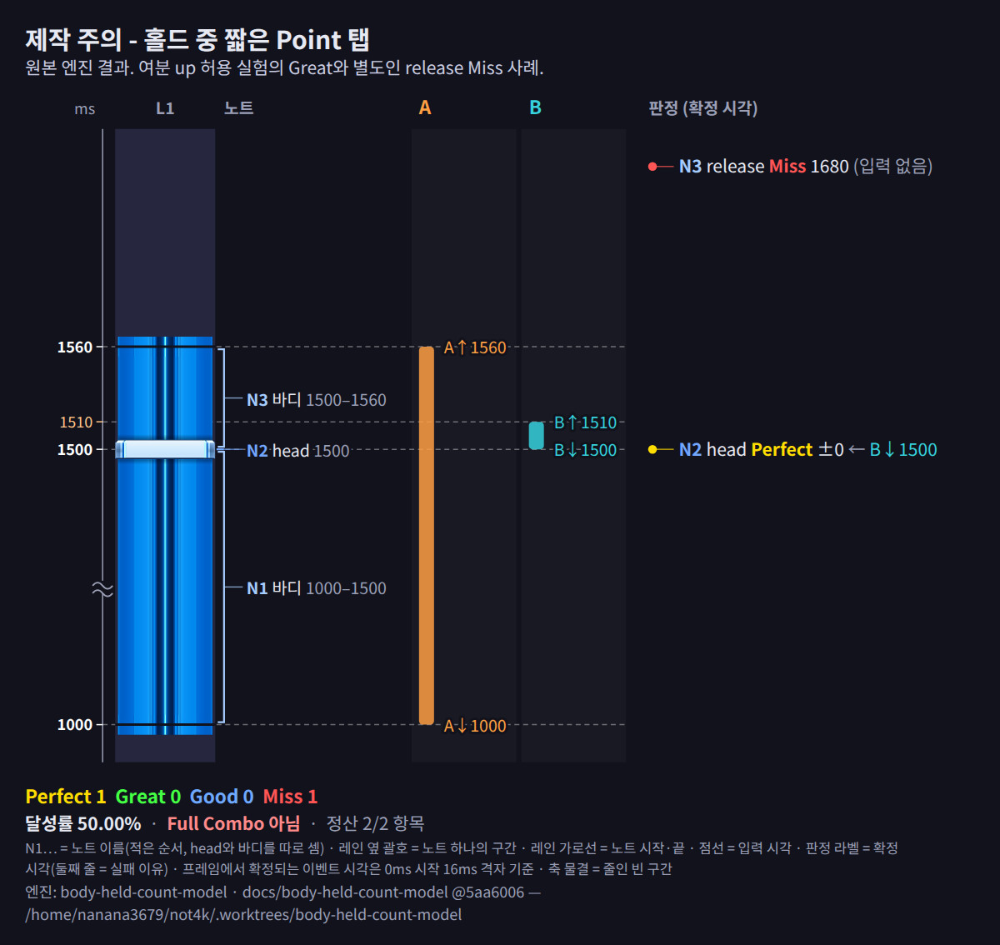
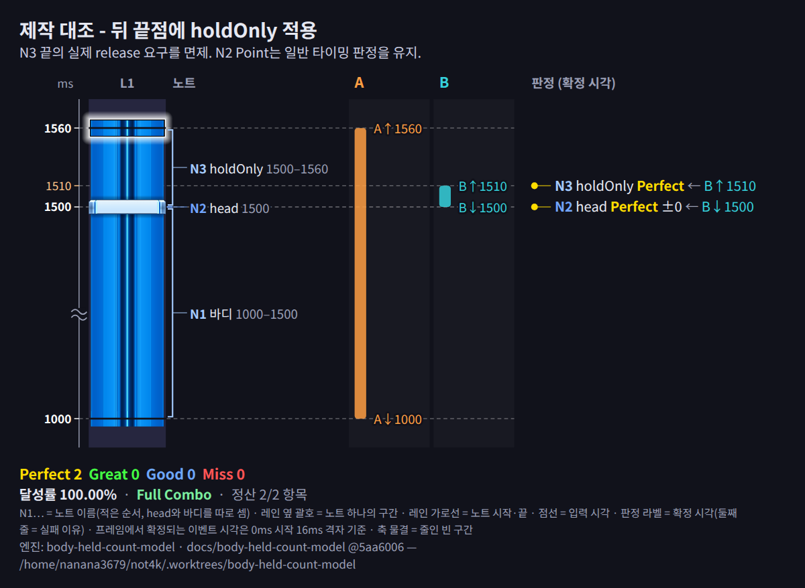

# not4k — 차트 디자인

이 문서는 not4k의 다중키 바인딩 메커니즘이 만들어내는 **고유한 차트 어휘**를 정의한다. 각 피스 개념이 기존 리듬게임의 어떤 경험에서 파생되었는지, not4k에서는 왜 가능한지, 그리고 유저에게 어떤 인식/입력 경험을 주는지를 함께 설명한다.

차트 제작자는 이 문서를 참고하여 not4k만의 차트를 설계할 수 있다.

> **노트 타입 vs 피스**: 이 문서에서 다루는 개념들은 복수의 노트가 배치를 통해 상호작용하는 **피스** 수준의 설계 어휘이다. 개별 노트 타입(싱글, 롱, 트릴, 더블)의 정의는 `note-system.md`를, 피스의 형식적 정의(PP-000 체계)는 `piece-definition.md`를 참고한다.

---

## 설계 원칙

### 1. 다중키 바인딩이 차트 공간을 확장한다

기존 4키 고정배치 게임에서는 한 레인에 연속 노트를 배치하면 반드시 연타가 된다. not4k에서는 같은 배치가 트릴로 처리될 수 있으므로, 연타의 물리적 제약에 묶여 있던 차트 공간이 열린다. 이 문서에서 다루는 피스들은 대부분 이 원리에서 파생된다.

### 2. 레인 분할 인식을 다양화한다

기존 4키 게임에서 유저는 레인을 2/2(왼손 2레인, 오른손 2레인)로 고정 분할하여 인식한다. not4k에서는 앵커가 한 손을 전담시키고, 수평 이동를 통해 반대 손이 내측 레인까지 담당하면 1/3, 3/1 같은 비대칭 분할이 가능해진다. 이는 차트 디자이너에게 완전히 새로운 설계 축을 제공한다.

### 3. 기존 게임의 차트 어휘를 재해석한다

아래 피스들은 무에서 창조된 것이 아니라, IIDX, 사운드 볼텍스, 츄니즘 등에서 이미 존재하는 경험을 not4k의 메커니즘으로 번역한 것이다. 기존 게임에서는 특수 하드웨어(스크래치, 노브, 슬라이더)가 필요했던 것을 PC 키보드의 다중키 바인딩만으로 재현한다.

---

## 피스 설계 개념

> 각 피스의 PLv.(피스 레벨)은 해당 피스가 본격 활용되는 최소 레벨이다. PLv.에 대한 정의와 피스별 상세 메타데이터는 `piece-definition.md`를 참고한다.

### 앵커 — PLv.7

#### 기존 게임에서의 대응

**IIDX의 스크래치 복합 패턴**: 스크래치가 연속으로 등장할 때, 한 손을 스크래치에 전담시키고 반대 손이 7개 건반 중 나머지를 모두 처리한다. 스크래치는 위-아래 회전이므로 버튼 연타보다 피로감이 훨씬 적다. 이때 반대 손은 평소 담당하지 않던 영역까지 커버해야 하므로, 유저의 레인 분할 인식이 강제로 바뀐다.

**사운드 볼텍스의 노브 + 건반 복합**: 한 손으로 아날로그 노브를 돌리면서 반대 손이 BT/FX 버튼을 모두 처리하는 패턴. 노브 조작은 연속 회전이므로 손가락 연타와 다른 종류의 부담을 준다.

#### not4k에서의 구현

1번 레인에 트릴 노트로 종연타를 배치한다. 1번 레인의 트릴 노트는 바인딩된 두 키를 교대로 입력하면 되므로, 한 손이 거의 자동적으로 1번 레인을 처리한다. 반대 손의 담당 범위는 배치에 따라 달라진다:

- **수평 이동 없이**: L2 비사용, 오른손은 L3+L4만 담당 (기본형, PLv.7)
- **수평 이동 포함**: 오른손이 L2+L3+L4를 모두 담당 → 가변 분할 1/3 (PLv.11)

#### 유저 경험

- **입력 난이도**: 트릴 측 손의 부담이 매우 낮으므로(스크래치 회전과 유사한 수준), 반대 손에 고밀도 배치를 해도 전체 난이도가 과도하게 올라가지 않는다.
- **수평 이동 포함 시**: 반대 손이 내측 레인(L2)까지 처리해야 하므로, 1/3 분할 인식과 손의 물리적 교차가 동시에 요구된다. IIDX에서 스크래치 복합 시 건반 처리와 유사한 인지 부하.

---

### 레인 내 분리 (홀드 + 탭) — PLv.7

#### 기존 게임에서의 대응

**IIDX의 Charge Note**: 롱노트가 진행되는 동안 해당 손가락이 묶이고, 나머지 손가락으로 다른 레인을 처리해야 한다. 묶이는 손가락의 위치에 따라 나머지 손의 동선이 크게 달라진다.

**츄니즘의 홀드 + 탭 공존**: 슬라이더의 한 영역을 한 손가락으로 누르고 있으면서, 같은 영역의 인접 지점에서 다른 손가락으로 탭을 처리하는 패턴. 물리적 칸막이가 없는 슬라이더이기에 가능한 메커니즘.

#### not4k에서의 구현

1번 레인에 키 A, B가 바인딩되어 있을 때: A로 롱노트를 유지하면서 B로 싱글 노트를 처리한다. 하나의 레인 안에서 "묶임 + 자유"가 동시에 발생한다. 표기법은 `-o` 심볼을 사용한다 (`piece-notation.md` 참고).

대표적인 처리 방식은 두 가지다. 짧은 뒤 바디에서는 탭·교대의 up과 release 창이 겹칠 수 있으므로, 아래 [차트 설계 시 주의사항](#차트-설계-시-주의사항)도 함께 적용한다:

- **홀드 중 탭**: A를 유지하면서 B로 탭.
- **릴리즈탭**: A를 떼면서 B를 눌러 홀드를 이어받는 키 교대 방식.

#### 유저 경험

- IIDX Charge Note의 "손가락 묶임"이 레인 내부에서 발생하는 새로운 경험.
- 기존 4키 게임에서 롱노트가 진행되면 해당 레인은 완전히 점유되었지만, not4k에서는 롱노트 진행 중에도 같은 레인에서 추가 입력이 가능하다.
- 물리적으로는 한 손의 두 손가락이 같은 레인을 분담하므로, 손가락 독립성이 요구된다.

---

### 비트 복합 트릴 — PLv.10

#### 개념

하나의 `trillZone`에 8비트, 12비트, 16비트, 24비트 등 서로 다른 비트 분할의 트릴 노트가 복합적으로 등장한다. BPM이 변하는 소플란과 달리 BPM은 일정하되, 비트 분할이 전환되면서 트릴 밀도가 구간별로 달라진다.

#### 유저 경험

- 트릴 측 손의 부담이 동적으로 변화한다. 느린 트릴(8비트)에서는 반대 손에 밀도 높은 배치를 할 수 있지만, 빠른 트릴(24비트)에서는 트릴 측 손에도 집중이 필요해지므로 반대 손의 배치를 단순화해야 한다.
- 차트 디자이너는 트릴 밀도와 반대 손 밀도를 반비례시킴으로써 전체 난이도를 일정하게 유지하거나, 동비례시킴으로써 난이도 스파이크를 만들 수 있다.

---

### 수평 이동 (크로스오버) — PLv.11

#### 기존 게임에서의 대응

**maimai의 교차 패턴**: 양팔이 교차하여 반대편 노트를 처리하는 패턴. 물리적 위치의 교차가 인지적 혼란을 유발한다.

#### not4k에서의 구현

추가 키를 이용하여 왼손으로 3번 레인, 오른손으로 2번 레인을 처리하는 배치. 1, 4번 레인은 물리적 거리로 인해 수평 이동 대상에서 제외한다.

#### 유저 경험

- 기존 2/2 고정 분할을 깨뜨리는 직접적 방식.
- 손의 물리적 위치가 교차하므로 인지적 혼란이 큼.
- 앵커가 분할 비율을 바꾸는 것이라면, 수평 이동는 분할 방향 자체를 뒤집는 것이다.
- 내측 레인(2, 3번)에서만 발생하므로 물리적 한계 내에서의 교차이다.

---

## 피스 조합 매트릭스

위 피스들은 독립적으로 사용될 수도 있고, 조합될 수도 있다. 아래는 조합 가능성과 예상 PLv.를 정리한 것이다.

| 조합                        | PLv.   | 난이도 등급 | 설명                                         |
| --------------------------- | ------ | ----------- | -------------------------------------------- |
| 앵커 단독                   | PLv.7  | 중급        | 내측 레인 비사용, 반대 손은 자기 영역만 담당 |
| 레인 내 분리 단독           | PLv.7  | 중급        | 홀드 중 탭의 첫 등장                         |
| 비트 복합 트릴              | PLv.10 | 중급 상위   | 8/12/16/24비트 등이 하나의 트릴에 복합 등장  |
| 앵커 + 수평 이동 + 가변 분할 | PLv.11 | 상급        | 1/3 배치. 반대 손이 내측 레인까지 담당       |

---

## 채택된 새 차트의 제작 계약

[RFD 0037](../rfd/0037-explicit-score-notes-and-body.md)의 **채택 계약, 구현은 후속 PR**이다. 아래 4～8항에 보존한 구형 연결 release·`holdOnly` 실험/제작 기록과 구별한다. 새 정의는 [glossary](glossary.md#바디)를 따른다.

- 바디는 hold 수를 요구하는 무점수 구간이며 down·up을 소비하지 않는다. 누름 Point·뗌 릴리즈·상태 확인 유지 노트는 의도한 위치에 각각 명시한다. 바디 끝·감소량에서 점수 항목이나 숨은 뗌을 자동 생성하지 않는다.
- 자연스러운 탭·교대의 up도 가장 이른 적격 명시 릴리즈를 처리할 수 있다. 숨은 연결 release가 대신 소비하거나 유지 유예가 등급을 취소할 것으로 기대하지 않는다. 타이밍 정밀도만 낮추려면 실제 뗌이 필요한 Grace 릴리즈를, 뗌을 요구하지 않으려면 릴리즈 없는 끝을 선택한다. 구형 `holdOnly`를 새 차트에 추가하지 않는다.
- 시작 Point를 처리한 down의 hold도 바디에 참여한다. 바디 시작 누름과 뒤 Point를 별개 입력으로 의도했다면 이른·늦은 시작과 Point 창의 간섭을 [10항](#10-바디-시작-누름이-뒤-point를-의도치-않게-처리하는-배치를-피한다)에 따라 대조한다. 엔진이 입력 의도를 추정해 Point를 제외하는 규칙은 없다.
- 같은 hold 수·같은 트릴 여부로 맞닿은 두 바디에는 뒤 시작 Point나 앞 끝 릴리즈를 명시한다. 둘 다 없으면 화면에서 하나의 바디와 구별되지 않는데 판정이 달라지므로 의미 위반이다. 같은 수 바디 끝에 길이 0 바디를 붙이는 대신 앞 바디 끝에 유지 노트를 둔다. 트릴 바디 → 일반 바디는 이 금지에서 빠지며 판정이 이어지지 않는다(사용자 결정, 2026-10-27, [glossary](glossary.md#의미-위반과-수리)). 1→2 증가의 뒤 두 몫 새 시작, Point 없는 2→1의 건강한 몫 승계·전체 탈락 유지를 같은 규칙으로 뭉뚱그리지 않는다([glossary](glossary.md#바디-판정과-실패-종속)).
- 유지 노트는 한 바디 내부·독립 길이 0·1→2·2→1에 배치할 수 있다. 공유 경계는 뒤 바디 기준으로 증가 시 두 표식·감소 시 한 표식이다. 같은 hold 수 연결점·트릴 바디 위는 금지한다. 자체 창이나 선판정은 없고 표식 시각의 바디 상태·시작/회복 대기·유효한 이른 종료의 정산을 따른다([glossary](glossary.md#유지-노트)).
- 같은 레인·같은 시각의 Point+릴리즈·Point+유지·릴리즈+유지는 금지한다. 길이 0 바디+Point와 길이 0 바디+릴리즈도 금지한다. 이는 실제 배치 제약이며, 서로 다른 시각의 판정 창 겹침이나 합법적인 바디 위 노트를 금지한 것은 아니다.
- 바디 hold 수와 릴리즈 수를 같게 강제하지 않는다. 명시하지 않은 릴리즈를 보충하거나 초과분을 줄이지 않는다. double 전체 끝의 릴리즈 하나와 2→1 감소의 싱글 릴리즈는 실패 귀속이 다르다. 감소 지점의 더블 릴리즈도 둘 수 있으며 두 키를 모두 떼고 뒤 single을 새 키로 잡는 연주를 요구한다(사용자 결정, 2026-10-26).
- 바디 정상 완료와 릴리즈 판정 대기는 별개다. 유지 표식 성공은 즉시 숨기고 미래 표식의 종속 0점은 즉시 실패색으로 보인다. 일부 성공 alpha 0.7의 공통 표시에서 유지 노트는 성공 표식만 숨기는 예외이며, 세부는 [판정 효과](glossary.md#판정-효과-confirmedjudgmenteffects)를 따른다.
- 구형 차트는 사람이 에디터에서 수정한다. 과도기에는 미수정 구형 의미와 새 의미를 섞어 저장·재불러올 수 있지만 구형 의미가 남으면 새 재생은 차단한다. 자동 배치 변환·`holdOnly`의 추정 치환과 구형 전용 배지/빗금은 추가하지 않는다. 실제 배치 위반의 표시·저장·플레이 제한은 유지하며 위반 항목의 선택 해제·다른 선택은 허용한다([glossary](glossary.md#구형-차트와-과도기)).

## 차트 설계 시 주의사항

> **후속 결정(엔진 이행 전):** [RFD 0035](../rfd/0035-release-presence-and-grace.md)에서 `holdOnly`를 폐지했다. 아래 `holdOnly` 배치·소비에 관한 지침은 이전 모델의 기록이다. 새 설계에서는 실제 뗌을 요구하면서 등급만 면제할 때 **그레이스 릴리즈**, 뗌을 요구하지 않을 때 **릴리즈 없음**으로 구분한다. 정의는 [glossary](glossary.md#release-판정), 적용 범위와 이행은 [PRD §12](../prd.md#12-미정-사항)를 따른다.

### 1. 트릴 노트는 "쉬운 손"을 보장해야 한다

앵커 피스의 핵심 가치는 "한 손의 부담을 줄여서 반대 손에 복잡한 배치를 할 수 있다"는 것이다. 트릴 측 레인에 트릴 노트 외의 복잡한 요소(더블 노트, 홀드 중 탭)를 동시에 배치하면 이 가치가 훼손된다. 앵커 구간에서 트릴 측 레인은 순수한 트릴만 유지하는 것이 원칙이다.

### 2. PLv.와 차트 Lv.를 일치시킨다

각 피스의 PLv.가 차트의 Lv.를 초과해서는 안 된다. 피스별 PLv.는 위 매트릭스 및 `piece-definition.md`의 PP-000 체계를 기준으로 한다.

### 3. 연타와 트릴의 선택은 유저에게 있다

트릴 노트가 아닌 일반 싱글 노트의 연속 배치는, 유저가 연타로 처리할 수도 있고 자발적으로 트릴로 처리할 수도 있다. 차트 디자이너가 "반드시 트릴로 처리해야 하는" 구간에서만 트릴 노트를 사용하고, 나머지는 유저의 선택에 맡긴다. 이것이 "가변 손배치"의 의미다.

### 4. 손 선택을 미리 암시한다

> **과도기 구형 계약·실험/제작 기록:** 이 항의 연결 release·`holdOnly`·자동 끝점 설명과 이미지는 당시 모델의 기록이다. 새 차트에는 위 [채택 계약](#채택된-새-차트의-제작-계약)을 적용한다. 손 선택을 미리 암시하고 자연스러운 down/up을 플레이테스트하는 제작 원칙은 유지한다.

4～6항과 8항은 손 선택과 자연스러운 up을 함께 고려하는 제작 지침이다(7항은 폐지). 패턴마다 판정이 점수 손해 없이 처리해야 하는 연주는 [의도된 연주](glossary.md#의도된-연주)로 정의한다. **[RFD 0032 §2-5](../rfd/0032-body-held-count.md#2-5-바디-중간-교대와-끝-창-안의-교대)의 단독 일반 롱노트 사례에서는 교대 up이 이른 release를 처리하며, 그 점수 손해가 차트의 의도가 아니라면 해당 끝에 Grace(`holdOnly`)를 적용한다고 확인했다.** [§1-2](../rfd/0032-body-held-count.md#1-2-패턴을-먼저-정하고-교대-자체의-점수-손해를-금지)의 교대 보호 목표를 모든 교대 up의 자동 면제로 해석하지 않는다. 연결 head의 교대·유지 중 탭은 [§4-1](../rfd/0032-body-held-count.md#4-1-연결-release)에서 up 하나를 연결 release에 배정하는 원칙을 확인했다. 나머지 적용 조건과 공통 계약은 계속 확인하며 엔진은 아직 변경하지 않았다.

특정 손으로 롱노트를 잡아야 뒤 배치를 자연스럽게 칠 수 있다면, **롱노트를 잡기 전에 반대 손이 다른 입력을 담당하게 만드는 흐름**으로 어느 손을 써야 하는지 충분히 암시한다. 첫 선택의 결과를 알기 어려운데 뒤늦게 다른 손으로 옮겨 잡도록 요구하는 배치는 지양한다.

예를 들어 L2·L3 롱노트 도중 L1·L2 Point를 배치하고, 오른손으로 L2·L3을 유지하면서 왼손으로 L1·L2를 치게 하려는 경우다. 앞선 배치에서 왼손을 쓰는 흐름을 만들고, 오른손이 L2·L3으로 이동할 시간과 여유를 준다. L2·L3을 왼손으로 잡도록 자연스럽게 유도한 뒤 갑자기 왼손을 비우라고 요구하지 않는다.

사용자가 제시한 Numpad 배치에서는 왼손 E/R로 잡은 L2·L3을 오른손 PageDown/Numpad7로 옮겨야 했다. 이 입력은 의도한 손 선택을 미리 알리지 않았을 때 생기는 부담의 예다. 특정 물리 키를 정답으로 강제하는 대신, 지원하는 키 배치에서 앞뒤 입력의 흐름으로 손 분담을 읽을 수 있는지 확인한다.

### 5. 자연스러운 탭·교대의 up과 가까운 release가 충돌하는 배치를 지양한다

> **과도기 구형 계약·실험/제작 기록:** 이 항의 연결 release·`holdOnly`·자동 끝점 설명과 이미지는 당시 모델의 기록이다. 새 차트에는 위 [채택 계약](#채택된-새-차트의-제작-계약)을 적용한다. 손 선택을 미리 암시하고 자연스러운 down/up을 플레이테스트하는 제작 원칙은 유지한다.

Point의 down뿐 아니라 **짧게 탭한 뒤 발생하는 up과 손을 옮기면서 발생하는 up**도 함께 설계한다. 한 키로 롱노트를 계속 유지하더라도 다른 키의 up이 실제 release 창 안에 들어갈 수 있다. §2-3의 release 계약(재검토 중)에서는 hold 수가 1→0이든 2→1이든 유효한 up을 후보로 받고, 가장 이른 적격 release 하나에 배정했다. §2-5에서 단독 일반 롱노트의 교대 up은 release로 인정했다. 반면 §4-1에서 확인한 연결 head의 교대·유지 중 탭에서는 up 하나를 연결 release에 배정하여 뒤 실제 release에서 제외한다. 두 경우를 구별하고 나머지 패턴도 각각 확인한다. 이런 배치를 일반적인 홀드 중 탭이나 자유로운 교대로 제시해 놓고, 알려주지 않은 추가 유지나 탭 길이 조절을 해야만 의도한 판정을 받게 만드는 것은 지양한다.

§2-3의 계약에서는 20ms 안에 다시 누르거나 다른 키로 hold를 유지하더라도 이미 발생한 release 등급을 취소하지 않았다. 제작자는 누르기만 확인하지 말고 자연스럽게 떼는 시점까지 실제 release 창과 대조한다. 유지 유예가 교대 up을 흡수해 줄 것을 전제로 정밀한 끝 판정을 배치하지 않는다.

대표 사례는 N1=`long 1000–1500`, N2=`head 1500`, N3=`long 1500–1560`이다. A는 1000–1560에 유지하고, B로 N2를 1500에 눌러 1510에 뗀다. 교대하지 않았어도 B의 up은 N3 끝보다 50ms 이르다. 여분 up을 release에 허용한 제한 실험에서는 이 up이 N3의 Great(-50)를 처리했다. §2-3의 계약에서도 이 입력을 release 후보로 받았으나, 후속 §4-1에서는 B up을 연결 release에 배정하고 A up 1560으로 N3 끝을 처리하는 연주를 정당한 것으로 확인했다. 새 기대 결과는 Perfect 2이며, 탭을 끝까지 길게 유지해야만 성공하도록 요구하지 않는다.



이미지는 `main` 5aa6006 원본의 실행 결과로, N2 Perfect / N3 release Miss를 보여준다. 이 Miss는 별도로 추적하는 기존 엔진 문제이며, 위 제한 실험의 Great와 구분한다. 제작 지침으로 엔진 결함을 정당화하지 않는다.

[원본 release Miss 추적: #281](https://github.com/nanana3679/not4k/issues/281)

이 연결 사례의 정상적인 두 연주는 탭 길이 조절이나 `holdOnly` 추가 없이 지원해야 한다. 연결 release에 배정되지 않는 up과 실제 release가 충돌하는 다른 배치에서는 간격을 조정하거나, 정밀한 release가 의도가 아니라면 끝에 `holdOnly`를 적용한다. N2에만 `grace`를 붙여서는 N3의 release 요구가 바뀌지 않는다. 아래는 N3를 `holdOnly`로 바꾼 기존 실험 대조로 Perfect 2가 나오지만, 정상 연결 연주를 허용하기 위해 반드시 붙여야 하는 속성이라는 뜻은 아니다.



이미지의 원본은 새 hold 수 모델의 구현 결과가 아니다. 실험 범위는 [RFD 0032 부록 A-2](../rfd/0032-body-held-count.md#a-2-시작-여부-검사로-연결-release를-대체)와 [§9-3](../rfd/0032-body-held-count.md#9-3-제작-지침-48항), 그 뒤의 패턴별 확인과 Grace 배치 기준은 같은 문서의 §2-5와 §4-1을 따른다. 두 이미지는 다음 명령으로 재생성한다.

```sh
pnpm -s case:image - --out docs/context/images/chart-design-point-tap.png <<'EOF'
제목: 제작 주의 - 홀드 중 짧은 Point 탭
노트: long 1000-1500 | head 1500 | long 1500-1560
입력: A 1000-1560 | B 1500-1510
메모: 원본 엔진 결과. 여분 up 허용 실험의 Great와 별도인 release Miss 사례.
EOF
pnpm -s case:image - --out docs/context/images/chart-design-point-tap-holdonly.png <<'EOF'
제목: 제작 대조 - 뒤 끝점에 holdOnly 적용
노트: long 1000-1500 | head 1500 | holdOnly 1500-1560
입력: A 1000-1560 | B 1500-1510
메모: N3 끝의 실제 release 요구를 면제. N2 Point는 일반 타이밍 판정을 유지.
EOF
```

### 6. 교대할 부분에 Grace를 배치한다

> **과도기 구형 계약·실험/제작 기록:** 이 항의 연결 release·`holdOnly`·자동 끝점 설명과 이미지는 당시 모델의 기록이다. 새 차트에는 위 [채택 계약](#채택된-새-차트의-제작-계약)을 적용한다. 손 선택을 미리 암시하고 자연스러운 down/up을 플레이테스트하는 제작 원칙은 유지한다.

손 교대를 허용하거나 유도하는 구간에는 **교대 동작에 정밀한 타이밍 부담까지 겹치지 않도록 Grace를 배치**한다. 앞선 배치로 손 선택을 암시하는 것과 함께 사용한다.

- 교대 위치의 Point에서 누르는 타이밍 부담을 낮추려면 `grace`를 적용한다. Good 창 안의 유효한 입력을 Perfect로 처리한다.
- 교대하면서 떼는 타이밍을 정밀하게 요구하지 않을 롱노트 끝에는 `holdOnly`를 적용한다. 특히 연결 release에 배정되지 않는 손 이동의 up이 끝 판정 창에 들어가는 배치라면 해당 끝의 release 요구를 면제하거나 끝점·Point 위치를 조정한다. 실제 release를 요구하는 대신 유지·완료 조건으로 판정하며, 20ms 유예로 release를 없애 주기를 기대하지 않는다.
- Point와 롱노트 끝에 필요한 면제를 각각 적용한다. 롱노트의 `holdOnly`와 같은 시각·레인의 Point가 공존할 수 없는 등 기존 배치 제약을 지킨다. 불가능한 위치에 속성을 덧붙이지 말고 경계와 Point 위치를 함께 조정한다.

Grace를 붙여도 바디의 유지 조건은 남는다. `holdOnly`는 up 자체를 없애거나 주변의 다른 일반 release에 대한 입력까지 막는 속성이 아니므로, 교대 때 발생하는 up이 어느 끝점을 처리하는지도 확인한다. 여러 release 창이 겹치면 단순히 가장 가까운 끝이 아니라 **처리 가능한 미처리 항목 중 차트 시각이 가장 이른 끝**을 함께 확인한다. Point의 `grace`만으로 롱노트의 release는 면제되지 않는다. 유지 유예는 hold가 부족한 짧은 공백에 대한 규칙이며 이 타이밍 면제와 역할이 다르다.

### 7. (폐지) 연결 head 뒤 짧은 바디와 감소 직전 head

> **과도기 구형 계약·실험/제작 기록:** 이 항의 연결 release·`holdOnly`·자동 끝점 설명과 이미지는 당시 모델의 기록이다. 새 차트에는 위 [채택 계약](#채택된-새-차트의-제작-계약)을 적용한다. 손 선택을 미리 암시하고 자연스러운 down/up을 플레이테스트하는 제작 원칙은 유지한다.

연결 head 뒤 바디의 끝을 그 head의 Good 창 안에 두는 배치와, head 없는 2→1 감소 지점 바로 앞에 head를 두는 배치를 지양하던 지침이다. 2026-10-16에 폐지했다([RFD 0032 §9-3](../rfd/0032-body-held-count.md#9-3-제작-지침-48항)).

- 이 배치에서 Miss가 나는 입력은 경계 뒤에 바디가 요구하는 수보다 키를 더 남긴 연주뿐이다. 의도된 연주(A·B를 경계에서 떼고 새 키로 head를 친 뒤 유지하는 `ab-c-` 등)는 판정 규칙이 점수 손해 없이 처리한다.
- 여분 키를 경계에서 떼야 한다는 구분은 튜토리얼 시연과 실습으로 전달한다([#286](https://github.com/nanana3679/not4k/issues/286), [#285](https://github.com/nanana3679/not4k/issues/285)).
- 이 구분을 요구하는 배치는 패터너가 그 점을 알고 넣으며, 밀도가 낮아도 낮은 레벨에는 쓰지 않는다. 어느 레벨부터 쓸지는 차트 제작 경험이 쌓인 뒤 [PRD의 미정 사항](../prd.md#12-미정-사항)에서 정한다.
- 정밀한 끝 판정이 의도가 아니면 뒤 바디 끝에 `holdOnly`를 적용할 수 있다(6항).

8항의 번호와 기존 링크를 유지하려고 이 자리를 남긴다.

### 8. `holdOnly` 끝에서 계속 누르는 연주도 불이익이 없게 배치한다

> **과도기 구형 계약·실험/제작 기록:** 이 항의 연결 release·`holdOnly`·자동 끝점 설명과 이미지는 당시 모델의 기록이다. 새 차트에는 위 [채택 계약](#채택된-새-차트의-제작-계약)을 적용한다. 손 선택을 미리 암시하고 자연스러운 down/up을 플레이테스트하는 제작 원칙은 유지한다.

`holdOnly` 끝은 일반 롱노트 끝과 같은 모양이라, 플레이어는 그 끝에서 뗄 수도(release 1) 있고 계속 누를 수도(release 0) 있다. 둘 다 정당한 연주다. 판정은 끝의 Good 창 안에서 뗀 up을 `holdOnly`가 가져가므로(등급은 항상 Perfect) 떼는 연주는 판정이 보호한다([RFD 0032 §7-1](../rfd/0032-body-held-count.md#7-1-holdonly-끝은-good-창-안의-up을-가져간다)).

- **기준:** 계속 누르는 연주도 불이익을 받지 않는지 확인한다. 계속 누른 키는 그 뒤에도 남아 있으므로, 그 키의 나중 up이 가까운 뒤 끝의 이른 release로 쓰이거나 뒤 판정에서 여분 키가 되는 배치를 피한다.
- head 없는 경계(같은 unit 수, 1→2 증가)에도 적용한다. 계속 누르는 연주(`a--- + ..b-`)와 앞 키를 떼고 다시 누르는 연주(`a-bc-`)가 모두 정당하고 경계 근처의 up 개수가 0 또는 1로 달라지므로, 경계 바로 뒤에 그 up에 따라 결과가 달라지는 판정을 두지 않는다([RFD 0032 §8-2](../rfd/0032-body-held-count.md#8-2-head-없는-경계)).
- 감소하지 않는 `holdOnly` 끝에 적용한다. `holdOnly` 감소에서 계속 누르는 연주는 기본적으로 의도된 연주가 아니며, 여분 홀드를 일부러 쓰게 짠 패턴만 예외다([RFD 0032 §7-2](../rfd/0032-body-held-count.md#7-2-holdonly-감소에서-키를-남기는-연주)).
- 이전 기준(`holdOnly` 끝 뒤 Easy Good 150ms 안에 up 개수 의존 판정을 두지 않음)은 끝에 정확히 뗀 up만 보호해 [RFD 0032 §9-3](../rfd/0032-body-held-count.md#9-3-제작-지침-48항)에서 바꿨다.

4～6항과 8항은 초견 플레이의 불합리함을 줄이기 위한 **제작·플레이테스트 지침**이다. 자동 배치 금지나 판정 엔진의 예외 추가를 뜻하지 않는다. 결정 근거는 [RFD 0032 §9-3](../rfd/0032-body-held-count.md#9-3-제작-지침-48항)과 [§2-3](../rfd/0032-body-held-count.md#2-3-release-등급과-자격-판정-창-기준), 후속 연결 사례의 범위는 [§4-1](../rfd/0032-body-held-count.md#4-1-연결-release), 짧은 뒤 바디는 [§6-3](../rfd/0032-body-held-count.md#6-3-head가-있는-21과-감소-release)과 7항을 폐지한 [§9-3](../rfd/0032-body-held-count.md#9-3-제작-지침-48항), 속성의 정의는 [Grace](glossary.md#grace-노트-grace-note)와 [holdOnly](glossary.md#holdonly-구-표기-유지-전용-롱노트)를 따른다.

### 9. `restZone`은 판넬 연출이 들어갈 만큼 길게 잡는다

> 게임은 `restZone`을 레인 판넬이 뒤로 넘어갔다 올라오는 연출로 보여 준다([RFD 0034](../rfd/0034-rest-zone-lane-panel.md), [Lab `restZone Lane`](../spec/lab-preview-catalog.md#restzone-lane)). 게임 구현 전까지는 dim으로 표시된다. 짧다는 이유로 손 파킹 창을 `restZone`에서 빼지 않는다.

`restZone` 길이(박이 아니라 시간)를 **추정 녹숫 + 판넬 애니메이션 2번** 이상으로 잡는다. [추정 녹숫](glossary.md#녹숫-green-number)은 차트 Lv.로 정하고(Lv.1 3000ms부터 Lv.15 500ms까지), 애니메이션은 300ms다. 그래서 최소 길이는 Lv.1 3.6초, Lv.8 2.35초, Lv.15 1.1초다(120 BPM이면 Lv.1 7.2박, Lv.15 2.2박).

판넬은 `restZone`이 시작되면 넘어가기 시작하고, 끝보다 추정 녹숫만큼 앞서 다 올라온다. 그래서 녹숫이 추정 이하인 사용자는 `restZone` 길이와 상관없이 애니메이션 중에 다음 노트를 보지 않는다. 다만 넘어감과 올라옴에 애니메이션이 한 번씩(300ms) 들고, 다 올라온 뒤 다음 노트가 레인 위끝에서 판정선까지 내려오는 데 추정 녹숫이 든다. 이 세 구간이 모두 `restZone` 안에 들어가야 판넬이 끝까지 넘어간다. 이보다 짧으면 덜 넘어가고, 추정 녹숫 이하이면 아예 넘어가지 않아 아무 표시도 없다. 추정보다 녹숫이 긴(스크롤이 느린) 사용자는 그 차이만큼 다음 노트를 판넬이 다 올라오기 전에 본다.

이 지침은 에디터가 검사하지 않는다. `restZone` 배치 제약(안에 노트·`trillZone` 금지)과 달리 어겨도 연출이 약해질 뿐 의미가 모순되지 않기 때문이다. 또 최소 길이는 Lv.로 정해지는데, 제작 중인 차트는 Lv.가 아직 정해지지 않은 경우가 많아 에디터가 검사할 기준이 고정되지 않는다. 이후 에이전트나 스크립트로 차트 리뷰를 만드는 기능에서 확인한다. 게임은 차트가 이 지침을 지킨다고 가정하고, 짧은 `restZone`에 dim 같은 다른 표시를 더하지 않는다([RFD 0034](../rfd/0034-rest-zone-lane-panel.md) 결정 5).

---

### 10. 바디 시작 누름이 뒤 Point를 의도치 않게 처리하는 배치를 피한다

**바디를 먼저 잡으려는 자연스러운 누름이 같은 레인의 뒤 Point까지 판정하게 배치하지 않는다.** 바디를 시작하는 입력과 뒤 Point를 치는 입력을 별개로 요구하려면, 앞 입력이 뒤 Point의 판정 창에 들어가지 않도록 배치를 설계한다.

- 바디 시작 정박만 확인하지 말고, 지원하는 판정 모드에서 허용하는 이른·늦은 시작 입력과 뒤 Point의 판정 창을 함께 대조한다. BPM에 따라 시간 간격이 달라지므로 고정된 박 수 하나를 안전 간격으로 쓰지 않는다.
- 바디 시작에 누르는 타이밍 판정이 필요하면 그 위치에 Point를 둔다. 별도 후속 입력을 요구하는 Point는 바디 시작 입력과 간섭하지 않게 간격을 조정한다.
- 홀드 중 탭은 계속 사용할 수 있다. 바디를 잡는 누름과 뒤 Point를 치는 누름이 의도대로 구분되는지 플레이테스트한다.

이는 **제작·플레이테스트 지침**이다. 바디가 시작 down을 소비하는 추가안은 철회했으며, 입력 의도를 추측하는 판정 예외나 에디터의 자동 배치 금지를 추가하지 않는다. 결정 근거는 [RFD 0032 §9-5](../rfd/0032-body-held-count.md#9-5-바디-시작-입력과-뒤-point의-간섭)를 따른다. 새 계약의 입력 미소비·명시 Point 원칙은 [RFD 0037 §3-3](../rfd/0037-explicit-score-notes-and-body.md#3-3-up-배정과-같은-키-재누름)으로 채택됐으며 구현은 #342다.

---

## 수록곡 BPM 분포 가이드라인

### 서비스 초반의 BPM 제한 근거

not4k는 새로운 노트 처리 방식(레인당 복수 키, 트릴/더블)을 제안하는 게임이다. 기존 리듬게임에 익숙한 유저라도 노트가 내려올 때 **어떻게 쳐야 할지 결정하는 시간**이 필요하다. 높은 BPM의 곡은 이 판단 시간을 압축시켜, 메커니즘 학습이 아닌 반사 속도 테스트가 되어버린다. 따라서 서비스 초반에는 높은 BPM의 곡을 많이 수록하지 않는다.

### 초기 수록곡 BPM 분포 (15곡 기준)

- **평균**: 155 BPM
- **표준편차**: 10 BPM
- **실질 범위**: 약 130～180 BPM (±2σ)

#### 구간별 곡 수

정규분포(μ=155, σ=10)를 10 BPM 구간으로 이산화한 배분:

| BPM 구간 | 확률  | 곡 수    |
| -------- | ----- | -------- |
| 130～139  | 6.1%  | 1곡      |
| 140～149  | 24.2% | 4곡      |
| 150～159  | 38.3% | 6곡      |
| 160～169  | 24.2% | 3곡      |
| 170～179  | 6.1%  | 1곡      |
| **합계** |       | **15곡** |

```
곡 수
 6 │        ██████
 5 │        ██████
 4 │    ██████████████
 3 │    ██████████████████
 2 │    ██████████████████
 1 │ ██████████████████████████
   └──────────────────────────▶ BPM
    130   140   150   160   170
```

이 분포는 유저가 not4k 고유의 메커니즘에 충분히 익숙해진 뒤, 이후 업데이트에서 고BPM(180+) 곡을 점진적으로 추가하는 방향을 전제한다.

---

## 관련 문서

- 노트 시스템 상세: `note-system.md`
- 피스 표기법: `piece-notation.md`
- 피스 정의 (PP-000 체계): `piece-definition.md`
- 난이도 설계: `../spec/difficulty-design.md`
- 스코어링: `scoring.md`
- 존재 이유: `rationale.md`
- 용어 사전: `glossary.md`
