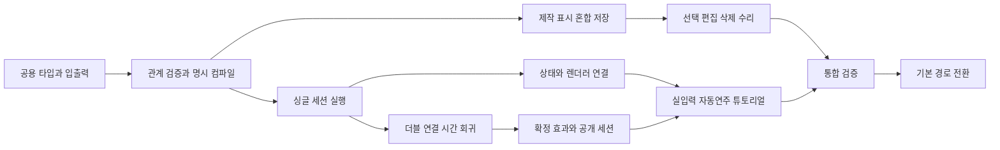

# 명시적 점수 노트 구현 계획

2026-10-25 작성, 2026-10-26 PR 분리 갱신. [RFD 0037](../rfd/0037-explicit-score-notes-and-body.md)의 바디·Point·릴리즈·유지 노트를 공용 모델, 판정, 에디터, 인게임에 적용한다. 공용 저장 모델과 정적 관계를 먼저 구현한 뒤 판정·에디터를 병렬로 진행하고, 실제 세션의 공개 상태가 준비되면 인게임을 연결한다. 마지막에 통합 결과를 검증하고 실제 기본 경로 전환을 준비한다.

이 문서는 구현 순서와 완료 기준이다. **이 PR(1/8)은 규칙 문서와 설계 사례만 도입한다.** 통합 작업트리의 구현·검증 기록은 아래 별도 기록으로 보존하며 이 브랜치의 구현 완료 상태로 읽지 않는다. 제품 규칙은 [glossary](../context/glossary.md), [게임 코어](../spec/game-core.md), [점수](../spec/scoring.md), [에디터](../spec/chart-editor.md)가 소유한다. 작업 상태와 제품 미정 사항은 [PRD §12](../prd.md#12-미정-사항)에서 관리한다. [이전 구현 계획](note-judgment-implementation.md)의 실행 기록은 보존하며, 새 모델의 구현 순서는 이 계획을 따른다.

## 기준과 범위

이 PR에서 문서·설계 사례 기준을 준비했다. [대표 사례 ENJ-01～18](../spec/explicit-note-judgment-cases.md)과 [기존 81건의 대응표](../spec/judgment-case-migration.md)는 새 실행 테스트의 기대값이다. 37건은 차트 표현을 옮겨 적용하고 44건은 승인된 규칙으로 기대값을 대체한다. 원본 81건과 `it.fails` 등록 상태는 구형 실행 기록으로 보존하며 새 엔진의 통과 수에 합치지 않는다.

구형 읽기·표시·속성·선택·편집·Undo와 구형/신형 혼합 저장을 첫 단계부터 보존한다. 차트 배치 자동 변환, `holdOnly` 추정 변환, 관리 대상 차트의 일괄 수정은 범위에 넣지 않는다. 사람이 새 에디터로 수리하며 구형 지원 종료는 사용자가 알린다.

준비 단계의 새 코어는 테스트와 개발용 미리보기에서 검증한다. 실제 플레이의 기본 경로 전환은 I2로 분리한다. 중간 재생은 [RFD 0040](../rfd/0040-countdown-and-note-reentry.md), 무점수 결과는 [RFD 0039](../rfd/0039-unscored-chart-results.md)로 확정했다. 입력 손실·연결 head Miss 정산 재검토·유지 유예 최종 튜닝은 PRD에 정한 시점에 다룬다. 기존 튜토리얼 목록 개편과 아직 미구현인 기록 저장·랭킹·모델 간 호환은 이번 전환에서 제외한다. 이를 공용 모델 착수 조건으로 당기거나 구현 편의로 새 정책을 확정하지 않는다.

## 현재 코드에서 바꿀 경계

| 현재 경계 | 구현에 필요한 변경 |
| --- | --- |
| [chart 타입](../../src/shared/types/chart.ts), [입출력](../../src/shared/chart/index.ts) | `PointNote`/`RangeNote`와 v3 저장만으로 새 의미를 구분할 수 없다. 구형 의미를 식별한 채 새 바디·릴리즈·유지 노트와 혼합 저장을 표현한다 |
| [auxAdapter](../../src/shared/chart/auxAdapter.ts), [에셋 저장](../../src/shared/songAssets/chartAssetPersistence.ts) | 메인/보조 파일 분리·병합, 속성·수량·의미 보존과 dirty 비교를 함께 이행한다 |
| [validation](../../src/shared/validation/index.ts) | 새 노트의 위치 관계를 공통으로 계산하고 구조 오류·의미 위반·새 재생 불가를 구별한다 |
| [ChartTiming](../../src/shared/timing/chartTiming.ts) | 박→ms 파생은 재사용한다. 바디 개수로 판정 수를 세는 경로를 새 점수 항목 집계와 분리한다 |
| [compiledJudgmentChart](../../src/game/judgment/compiledJudgmentChart.ts) | 바디 끝·감소량·`holdOnly`에서 점수를 자동 생성한다. 새 컴파일러는 명시 노트만 항목으로 만들고 바디 몫과 관계는 별도로 만든다 |
| [JudgmentCore](../../src/game/judgment/JudgmentCore.ts), [세션](../../src/game/judgment/NoteJudgmentSession.ts) | 공개 이벤트와 compiled 타입에도 구형 의미가 들어 있다. 새 코어만 `createCore`에 꽂는 것으로 이행을 끝내지 않는다 |
| [에디터 store](../../src/editor/stores/editorStore.ts), [편집 적용](../../src/editor/editing/editApplication.ts) | 새 엔티티를 실제 선택·트랜잭션·history·저장 경로에 포함하고 위반 수리 흐름을 연결한다 |
| [PlayScreen](../../src/game/screens/PlayScreen.tsx), [표시 어댑터](../../src/game/judgment/SessionRendererAdapter.ts) | 현재 상태와 확정 효과를 새 세션에서 받아 표시한다. 렌더러가 판정이나 실패 종속을 다시 계산하지 않는다 |

새 코어는 DOM·Pixi·오디오·Zustand에 의존하지 않는다. 기존 시간 처리·hold 추적·Point·트릴·점수·입력 수집 코드는 새 계약과 양립하는 부분만 재사용한다. 등록 키·숨은 연결 up 소비·바디 자동 점수에 묶인 구현을 그대로 옮기지 않는다.

## 공통 계약과 소유권

구체적인 JSON 필드·버전·배열·ID·API 이름은 C1～M1에서 코드로 정한다. 아래 표는 공유해야 할 정보와 책임을 고정한다.

| 경계 | 공유할 정보 | 소유자 |
| --- | --- | --- |
| 저장과 편집 문서 | 항목별 구형/신형 의미, 명시 수량·Grace, 메인/보조 자료와 메타데이터 | 모델 담당 |
| 정적 관계와 진단 | 시작 Point, 앞뒤 바디, 릴리즈의 끝점/단독 관계, 유지 소속과 뒤 바디 경계 귀속, 위반 대상 참조 | 모델 담당 |
| 컴파일된 차트 | 원본 참조, 점수 항목과 가중치, 바디 몫, 실제 경계, 시각과 트릴 귀속 | 모델 담당 |
| 세션 현재 상태 | 바디 몫의 시작·유지·실패·정상 완료와 Point/릴리즈/유지 항목 상태 | 모델 담당 |
| 불변 확정 사실과 효과 | 항목 정산·무점수 실패·종속 0점, raw 입력/확정 시각, 표시용 등급/타이밍과 레인 효과 | 모델 담당 |
| 편집 명령 | 실제 선택 집합, 생성·이동·축소·삭제·Cut·clipboard·Undo/Esc와 수리 | 에디터 담당 |
| 표시와 입력 소비자 | 상태의 스킨 합성·화면 수명, 실입력·AutoPlayer·튜토리얼의 세션 연결 | 인게임 담당 |

위 표의 원본 참조, 점수 항목 참조, 바디 몫 참조, 반복 재생의 표시 인스턴스는 구분한다. 에디터가 저장된 소속 ID를 사용자에게 요구하거나 화면 객체의 ID를 점수 정산 ID로 사용하지 않는다. 정적 관계는 lane·Beat에서 도출하고 ms 근삿값으로 맞닿은 경계를 추정하지 않는다.

공통 저장/관계 코드는 `src/shared`가 소유한다. 판정용 컴파일·코어·세션·정산은 `src/game/judgment`와 scoring이 소유한다. 에디터가 판정 내부 상태를 가져오거나 인게임이 편집 store에 의존하지 않게 한다.

## 단계와 의존성

각 행은 독립적으로 검증할 작업 단위다. 큰 행은 같은 완료 기준 아래 여러 PR로 나눌 수 있다. 병합·배포를 이 표의 완료와 같은 뜻으로 사용하지 않는다.

| 순서 | 작업 | 선행 조건 | 완료 결과 |
| --- | --- | --- | --- |
| C1 | 공용 타입과 저장 왕복 | 확정 문서와 착수 기준선 | 구형·신형·혼합 차트를 의미 손실 없이 읽고 저장 |
| C2 | 관계·검증·명시 컴파일·재생 harness | C1 | 같은 관계/진단을 소비하고 바디 자동 점수가 없는 실행 입력 생성 |
| M1 | 싱글의 처음부터 정산까지 | C2 | 실제 새 컴파일러→코어→세션→점수의 최소 경로 통과 |
| M2 | 더블·연결·시간·실패 종속 | M1 | ENJ-01～15·18과 HC001～081의 새 기대값 실행 통과 |
| M3 | 확정 효과와 공개 세션 마무리 | M2 | ENJ-16·17, 순서 독립·일회성 효과·최종 분모 검증 |
| E1 | 새 항목 제작·표시·혼합 저장 | C2 | 새 차트 제작과 구형 수리를 에디터에서 수행 |
| E2 | 선택·편집·삭제·취소·수리 | E1 | 확정한 편집 동작과 위반 저장 차단을 일관되게 적용 |
| G1 | 새 상태를 스킨과 렌더러에 연결 | M1 공개 상태. 에셋/manifest 준비는 C1부터 | 새 노트·몫별 상태·화면 수명을 공개 상태로 표시 |
| G2 | 실입력·AutoPlayer·튜토리얼·Lab | M3와 G1 | 모든 소비자가 같은 세션과 일회성 효과 경로 사용 |
| I1 | 에디터와 인게임 통합 검증 | E2와 G2 | 제작→저장→재불러오기→처음부터 테스트 플레이가 연결 |
| I2 | 실제 기본 경로 전환 준비와 적용 | I1 및 전환에 필요한 PRD 결정 | 결과·시작 흐름·롤백을 검증하고 기본 경로 전환 |

## 단계별 구현과 완료 기준

### C1 공용 타입과 저장 왕복

새 바디·릴리즈·유지 노트와 구형 항목의 의미를 항목 단위로 보존하는 타입을 만든다. 기존 Point·트릴·차트 이벤트와 구형 포맷 읽기도 유지한다. 저장 형식의 버전·구분 방식은 이 단계에서 정하고 reader/writer·aux 경계·dirty 스냅샷에 함께 적용한다.

- 바디 hold 수와 릴리즈 수량을 자동으로 맞추지 않는다. 같은 더블 릴리즈 안의 일반/Grace 구분은 하나로 보존한다.
- 파일을 읽는 것만으로 구형 항목에 릴리즈/유지를 추가하거나 새 의미로 바꾸지 않는다. 기존 형식의 호환 파싱은 의미 보존 범위에서 유지한다.
- **완료 기준:** 구형만·신형만·혼합, 양수/길이 0, 메인/보조, 일반/Grace·싱글/더블의 serialize→parse 왕복과 메타데이터·dirty 검증이 통과한다. 새 의미를 잘못 구형으로 읽는 경로를 차단한다.
- **주요 위치:** `src/shared/types/chart.ts`, `src/shared/chart/`, `src/shared/songAssets/`, `src/shared/timing/chartTiming.ts`의 새 타입 수용, 이에 연결된 I/O 소비자.

### C2 정적 관계와 컴파일

정적 관계를 한 번 도출하여 validation·에디터·컴파일러가 공유하게 한다. 구조 오류, 편집 중 허용할 의미 위반, 구형 항목으로 인한 새 재생 불가를 별도 결과로 취급한다. 구형 항목 존재만으로 혼합 저장을 거부하지 않는다.

명시 Point·릴리즈·유지의 한 몫당 가중치 3인 점수 항목을 생성한다. 바디 몫은 점수 항목과 별개이며 명시 노트가 없는 끝·감소 지점에는 항목을 만들지 않는다. 새 분모·판정 수는 이 항목 목록에서 읽고 `ChartTiming.judgmentCounts`의 구형 타입별 집계를 새 점수 기준으로 사용하지 않는다. 같은 수 연결도 실제 두 바디와 경계를 유지한다. 트릴·restZone·stop·메인/보조의 기존 범위를 함께 검증한다. [RFD 0038](../rfd/0038-release-notes-in-trill-zones.md)에 따라 같은 레인의 `trillZone` 시작·끝을 포함한 모든 명시 릴리즈 배치는 의미 위반으로 진단한다.

- **완료 기준:** 위치 제약과 경계 귀속, 원본 참조·항목/몫 식별, 명시 수량과 이론 분모가 정적 테스트에서 일치한다. 새 compiler는 구형 의미가 남은 게임 차트를 거부한다.
- **재생 기반:** ENJ 설계 JSON을 실행 차트로 오인하지 않는다. 명시적 실행 fixture와 입력/기대값을 별도로 만들고 ENJ·HC ID와 출처를 유지한다. harness가 실제 compiler와 실제 session을 호출하게 한다.
- **공유 결과:** 에디터가 쓸 저장 타입·관계·진단을 고정하고, M1에서 검증할 입력·상태·확정 효과 경계를 제시한다. 이후 변경은 소비자와 테스트를 함께 수정한다.

### M1 싱글 세션 실행

독립 Point와 싱글 바디의 실제 시작·유지·정상 종료·실패, 명시 릴리즈와 유지 노트를 실제 시간 진행으로 구현한다. 처음부터 명시 항목 정산과 무점수 Miss·종속 0점까지 연결하여 상태 함수만 통과하는 부분 구현을 피한다.

preheld/fresh down, 시작 창 끝·유지 유예, 실제 시작 뒤 이른 종료, 끝이 지난 유효한 첫 시작, 일반/Grace 릴리즈, 유지 보류·회복·이른 종료 일괄 정산을 다룬다. Point/릴리즈 소비와 바디/유지의 입력 미소비를 같은 경로에서 검증한다.

- **완료 기준:** ENJ-01～09·18과 Point·바디·유지·릴리즈가 함께 있는 싱글 세션을 실제 새 compiler→core→session→score 경로로 통과한다. 기한 처리 후 미정산·중복 정산이 없다.
- **공유 결과:** 시작·실패·완료와 항목별 상태를 읽는 snapshot 및 불변 확정 효과의 최소 공개 계약을 실제 실행으로 검증한다. G1은 이 계약을 소비한다.

### M2 더블과 경계 및 시간 회귀

몫별 상태를 더블로 확대하고 같은 수 단순 연결·릴리즈 경계·1→2·2→1, Point 담당 몫과 건강한 승계를 구현한다. 전체 끝의 단일 릴리즈와 감소 릴리즈의 실패 귀속을 구별한다. 같은 키 재사용은 해당 시작 Point를 실제 처리한 예외에만 허용한다.

raw 입력 시각·관측 시각·확정 시각과 같은 키의 down/up 인과관계를 보존한다. 동일 raw 시각의 서로 다른 키는 적격 배정을 함께 대조하고, 기한 경계 입력·늦은 관측·프레임 분할로 확정 사실을 번복하지 않는다. 길이 0·짧은 바디·트릴과 기존 계약에 맞는 Point 회귀도 포함한다.

- **완료 기준:** ENJ-01～15·18과 HC001～081의 새 fixture가 실제 세션에서 통과한다. HC027은 원본의 부분 단언 범위를 유지한다. 기존 81건을 그대로 복사해 새 테스트의 `it.fails`로 남기지 않는다.
- **불변식:** 한 실제 입력의 점수 항목 소비 상한, 실패/완료 불가역, 몫별 실패 보존, 종속 추가 Miss 없음, 유지 추가/제거에 따른 기존 입력·바디 결과 불변을 검증한다.

### M3 확정 효과와 세션 정산

`ScoreManager`·콤보·확정 효과를 새 명시 항목에 연결하고 정산 사실의 단일 소유자를 정한다. 새 세션 snapshot을 읽는 것과 효과를 한 번 적용하는 동작을 분리한다. 모든 항목을 종료 기한까지 진행한 뒤 고정 이론 분모와 맞춘다.

같은 확정 시각의 대표 글자는 가장 낮은 등급을 고르고, 그 등급의 표시 가능한 실제 입력 중 절대 raw 오차가 가장 큰 입력의 타이밍을 쓴다. 유지·Grace·종속 0점에 새 타이밍을 만들지 않는다. 각 항목의 점수·통계·콤보·고도·레인 효과는 대표 글자 선택과 별도로 정산한다.

- **완료 기준:** ENJ-16·17과 전 대표 사례, 확정 순서/동일 timestamp·phase Miss 우선, 같은 확정 시각의 호출 분할, finalize·재조회·어댑터 재부착의 비중복 테스트를 통과한다.
- **주요 위치:** `src/game/judgment/NoteJudgmentSession.ts`, `confirmedJudgmentEffects.ts`, `ConfirmationCombo.ts`, `src/game/scoring/ScoreManager.ts`와 새 코어의 공개 경계.

### E1 새 항목 제작과 혼합 저장

공용 타입·관계·진단으로 toolbar·생성·타임라인·hit·위반 표시·속성·파일 입출력을 연결한다. 단독 릴리즈 직접 배치, 일반 Point 드래그의 Point+바디+릴리즈 한 생성/취소/Undo, 바디 위 유지 수량, 빈 위치 길이 0 싱글 생성과 재클릭 더블 변경을 구현한다. 트릴 드래그는 Point+바디만 만들며 `trillZone` 안 릴리즈는 생성하지 않는다([RFD 0038](../rfd/0038-release-notes-in-trill-zones.md)). 릴리즈의 싱글/더블·일반/Grace를 생성하고 더블 노트는 하나의 편집·삭제 단위로 다룬다. 구형 항목은 기존 의미와 표시로 수리할 수 있게 한다.

- **완료 기준:** 신형 제작과 구형/신형 혼합 저장·재불러오기, 메인/보조 왕복·dirty·Undo를 실제 editor store와 파일 경계에서 검증한다. 구형 전용 배지·새 자동 변환을 추가하지 않는다.
- **주요 위치:** `src/editor/modes/CreateMode.ts`, toolbar·timeline 렌더러/hit, `stores/`, `hooks/useFileOperations.ts`와 shared I/O 소비자.

### E2 선택과 편집 및 수리

실제 선택 집합이 이동·복사·끝 resize·삭제·Cut을 결정하게 한다. 노트 우선 hit, 바디 동반 선택, 토글 제외 보존, 직접 노트 삭제·미선택/선택 바디 우클릭·Delete의 범위 차이를 구현한다. 선택에서 빠진 소속 유지가 있으면 바디 삭제/Cut을 막고, 축소 보호는 위반 임시 확정과 구별한다.

우클릭 드래그의 관통 삭제 방지·한 조작 Undo·Esc 복구를 하나의 편집 트랜잭션으로 다룬다. 의미 위반은 미리보기부터 빗금으로 표시하고 확정·선택 해제·교체를 허용하되 저장/플레이를 막는다. 구조 오류 거부는 유지하고 [RFD 0017 추가 4](../rfd/0017-optimistic-edit-transient-invalid.md#3-4-구조의미-분류-확정-소비자-감사-2026-07-09)의 `trillZone` 위반 축소 차단과 그 `SelectMode` 회귀 테스트를 함께 구현한다.

- **완료 기준:** 선택된 것만 복사/이동, 제외 릴리즈의 잔류, 선택 릴리즈만 resize 동반, Cut 거부 시 clipboard/history 불변, 선택 인덱스 보정, 우클릭·Esc·Undo/Redo와 터치 입력의 공통 경로를 검증한다.
- **주요 위치:** `SelectionSlice`, `SelectMode`, `DeleteMode`, `ClipboardManager`, `resolveGrab`·hitTest, store·editApplication·키보드/포인터 훅. 각 명칭은 [에디터 컨텍스트](../../src/editor/CONTEXT.md)의 기존 책임을 따른다.

### G1 상태와 스킨 연결

확정된 에셋과 현재 skin manifest를 대조하고 새 바디·명시 릴리즈·유지의 독립 표시 경로를 만든다. 별도 바디 시작/끝 노트를 추가하지 않는다. 에디터와 공유할 스킨 계약은 인게임 담당이 소유하고 에디터 담당과 맞춘다.

정상 완료 바디/성공 유지 즉시 숨김, 실패 원위치 잔류, 일부 실패 절반 실패색과 일부 성공 전체 alpha 0.7의 합성, 유지 개수 예외, Grace 외곽 밝기를 snapshot에서 표현한다. 판정 대기·실패 종속은 렌더러가 raw held나 차트 배치로 재추론하지 않는다.

- **완료 기준:** 공개 상태 fixture로 모든 대기/부분/완료/실패 조합과 바디·릴리즈의 별도 수명을 검증한다. 이후 G2/I1에서 실제 세션으로 같은 표시를 검증한다.
- **주요 위치:** `src/game/skin/`, `GameNoteRenderer`, `GameRenderer`, `SessionRendererAdapter`, `JudgmentUI`. 스프라이트 pool 재사용·화면 밖 제거·dispose와 기존 스킨 미리보기 영향도 확인한다.

### G2 입력과 모든 재생 소비자

실입력·AutoPlayer·튜토리얼·Lab을 같은 compiler/session 경계에 연결한다. AutoPlayer는 성공 이벤트를 직접 주입하지 않고 합법적인 물리 down/up을 생성한다. 트릴 교대·더블의 두 키·명시 릴리즈 입력도 같은 경로로 처리한다.

튜토리얼과 개발 예제는 새 의미를 명시하여 수정한다. 기존 사례·보관 스킨·해시로 고정한 시연 기록은 덮어쓰지 않는다. 반복 재생마다 새 세션/표시 인스턴스를 만들고 raw 입력·보류 후보·이미 적용한 효과가 다음 반복에 새지 않게 한다.

- **완료 기준:** 같은 입력을 실입력 어댑터·AutoPlayer·튜토리얼에서 재생해 같은 판정/정산을 얻는다. 정상 종료·재시작·프리뷰 반복·dispose에서 효과 중복과 키 잔류가 없다.
- **주요 위치:** `InputSystem`, `AutoPlayer`, `PlayScreen`, `screens/songSelect/tutorialPreview*`, `src/lab/judgmentCase/`와 판정 playtest. 개발 미리보기는 [Lab 규칙](../agents/lab-previews.md)에 따라 등록한다.

### I1 에디터와 인게임 통합 검증

새 에디터에서 만든 차트를 저장·재불러온 뒤 처음부터 테스트 플레이한다. 위반은 편집 화면에서 수리 가능하고 저장/플레이 진입에서 같은 이유로 차단돼야 한다. 구형·혼합은 수리와 저장이 가능하지만 새 게임 차트에 구형 의미가 남으면 새 재생을 거부한다.

- **완료 기준:** 단위 테스트와 실제 브라우저에서 제작→선택/수정→Undo/Redo→저장 왕복→재생→확정 효과→결과 수치가 일치한다. 실제 renderer에 연결한 대표 성공·실패·부분 표시를 확인한다.
- **회귀 범위:** game/editor/Lab E2E, 튜토리얼 수명과 GPU/Pixi teardown, 기존 호환 테스트, production·Lab build. 새 테스트의 커서 범위 선택과 기존 세션의 되감기 복원을 구별한다.

### I2 기본 경로 전환

일반 첫 재생·Retry는 에셋 준비 뒤 음악 준비 3초 없이 즉시 시작한다. 테스트 플레이의 초기 준비는 유지하고, 일반/테스트의 일시정지 재개는 [RFD 0040](../rfd/0040-countdown-and-note-reentry.md)의 곡 시간 고정 3초 되감기와 이후 상태 복원·실제 시간 3초 음악 준비를 적용한다. 새 커서 테스트의 항목 범위와 원본·source 참조를 보존한다.

무점수 차트는 [RFD 0039](../rfd/0039-unscored-chart-results.md)에 따라 재생을 허용하고 전체 이론 가중치가 0이면 달성률·랭크를 숨긴다. 점수 항목의 전부 Miss는 0%·F다. 일반 문서 로딩·첫 시작/Retry·공식 결과·구형 런타임의 명시 항목 거부를 각각 검증한다.

기존 튜토리얼 목록 개편은 사용자 결정으로 후속 분리한다(2026-10-26). 아직 미구현인 기록 저장·랭킹과 모델 간 호환은 이번 전환의 선행 조건으로 두지 않으며 해당 기능 구현 때 설계한다(2026-10-25). 새 차트의 읽기·원본은 전환/롤백에서도 보존하고 구형 런타임에서 새 차트를 구형 의미로 조용히 실행하지 않는다. 연결 head Miss 정산·임시 유지 유예 20ms의 최종 튜닝은 새 코어 실플레이를 근거로 재검토한다. 미정·후속 사항은 [PRD §12](../prd.md#12-미정-사항)에서 추적한다.

I2(#347) 뒤 일반 곡 선택은 명시 판정만 실행한다. 현재 운영 차트(노트가 있는 구형 v3 차트 8개와 aux 없는 빈 차트 2개)는 사람이 새 계약으로 다시 제작하기 전까지 곡 선택에서 플레이할 수 없다. 미출시라 사용자가 이 공백을 감수했다(2026-10-26). 전체 저장소 차트 수리를 구현 완료의 대리 작업으로 자동 수행하지 않는다. 사용자가 과도기 종료를 알리기 전까지 구형 읽기·편집·혼합 저장을 제거하지 않는다. 구형 판정 런타임 정리와 구형 수리 지원 종료는 별도 작업이다. PR 이해 확인·병합·배포는 저장소 절차와 사용자 승인 범위를 따른다.

## PR 제출 순서

2026-10-26 기준 통합 구현은 원본 `judgements` 작업트리에서 검증한 상태다. 이 PR은 최신 `origin/main`의 문서 전용 브랜치에 1단계만 옮긴다. 아직 열린 [PR #335](https://github.com/nanana3679/not4k/pull/335)의 브랜치와 미커밋 통합본은 보존하며 PR 2～8은 별도로 준비·검증한다.

| 순서 | PR 범위 | 주요 경계와 검증 |
| --- | --- | --- |
| 1 | 규칙 문서와 설계 사례 | RFD 0037～0040, glossary·관련 spec, ENJ 18건과 HC 81건 대응. 채택 규칙과 구현 진척을 구별하고 아직 도입하지 않은 v4/API 문서는 다음 PR에 둔다 |
| 2 | 공용 차트 문서 | `src/shared`의 타입·main/aux 입출력·관계·검증, `docs/spec/chart-format.md`. 구형·혼합 저장 왕복과 구형 소비자 경계를 검증한다 |
| 3 | 판정 코어와 세션 | 명시 컴파일러, 코어·세션·공개 상태·점수·이력 복원. ENJ/HC, 동시 입력, 중복 정산 방지와 되감기 단위 테스트를 포함한다 |
| 4 | 스킨과 표시 | `classic-explicit` 생성 계약·loader·renderer·판정 UI·표시 확인 Lab. 기존 스킨 보존과 상태 표시를 검증한다 |
| 5 | 에디터 제작과 편집 | 새 노트 표시·생성·선택·복사·삭제·Undo·저장. PR 4의 스킨 loader를 사용하고 새 재생 화면 진입은 PR 7에서 연결한다 |
| 6 | 판정 사례 이미지 도구 | `case:image`의 설계 도식·새 엔진 실행과 구형 엔진 호환. 문법 문서·CLI와 이미지 생성을 검증한다 |
| 7 | 명시 테스트 재생 | 실입력·AutoPlayer·음악 준비·3초 되감기·자원 해제·debug, 에디터/Lab 재생 진입. 일반 곡 선택의 기본 전환은 마지막에 한다 |
| 8 | 일반 재생 기본 전환 | main/aux 로딩·Loading·store·App 분기·공식 결과, 일반 첫 시작/Retry·구형 main 거부와 관련 E2E. 통합 뒤 전체 검증을 기록한다 |

`index.ts`, store, CONTEXT와 spec처럼 여러 단계에 걸치는 파일은 변경 단위로 나눈다. 에디터의 명시 renderer가 스킨 loader에 의존하므로 최초 계획의 PR 4·5 순서를 조정했다. 각 PR 시점에 존재하는 의존성만 참조하고 해당 변경의 테스트·타입·빌드를 다시 실행한다. PR 1은 문서 링크·앵커·공백과 ENJ/HC 자료·원본 해시를 검사하며 타입·빌드는 실행하지 않는다. 통합 워크트리의 5,260건 통과는 분리한 각 PR의 검증을 대신하지 않는다.

먼저 최신 `main`과 #335의 차이를 대조한다. #339로 이미 `main`에 들어간 동일한 원본 에셋 132파일은 다시 추가하지 않는다. [PR #338](https://github.com/nanana3679/not4k/pull/338)의 구형 제안과 RFD 0037의 철회·대체 관계를 문서 PR에 명시한다. 기존 PR 수정·닫기와 머지는 이 분리 계획에 포함하지 않는다. 각 PR 본문에는 [리뷰 중요도](../agents/pull-requests.md)와 필수 파일별 변경·위험·읽는 순서를 적는다.

## 검증 방법

착수 시 현재 dirty 변경을 기록하고 관련 테스트·전체 단위 테스트·타입 검사·lint의 기준선을 남긴다. 기존 실패와 변경으로 생긴 실패를 구별한다. 계획 작성 시점의 테스트 개수나 이전 단계의 통과 기록을 새 실행 증거로 사용하지 않는다.

| 시점 | 검사와 증거 |
| --- | --- |
| 각 구현 작업 | 변경 소스 옆 `*.test.ts`, 한국어 상황·행동·결과 테스트명. `pnpm exec vitest run <관련 경로>`부터 실행 |
| C1·C2 및 모듈 간 연결 변경 | 관련 회귀 뒤 `pnpm test`와 `pnpm typecheck`. 저장 타입 확대로 기존 소비자가 누락되지 않는지 확인 |
| M2·M3 | ENJ 18건·HC 81건을 실제 새 세션으로 재생한 대응 목록, 점수/소비/상태/확정 효과와 실패 비중복 |
| 입력과 시간 변경 | 키 이름·레인·노트 저장 순서·같은 시각 서로 다른 키 순열, 1ms·8ms·약 16.7ms·불규칙 update, raw/observed 분할과 재조회 대조 |
| 유지 노트 변경 | 같은 바디·Point·릴리즈·입력에 표식만 추가/제거하여 기존 진행·입력 배정·실패 효과가 같은지 비교 |
| E1·E2 | 실제 store/명령의 통합 테스트, 기존 `e2e/editor`의 파일·canvas·keyboard·toolbar 흐름 갱신 |
| G1·G2 | 상태 표시 단위 테스트와 `e2e/game`의 판정·튜토리얼·반복·teardown, `e2e/lab`의 판정/스킨 미리보기 |
| I1·I2 | `pnpm test`, `pnpm typecheck`, `pnpm lint`, `pnpm build`, `pnpm build:lab`, `pnpm test:e2e --project=editor --project=game --project=lab` |

생성 입력 검증은 작은 합법 차트부터 시작하고 고정 seed·최소 반례·입력/확정 trace를 남긴다. 서로 다른 raw 시각이나 같은 키의 인과관계를 무작위로 뒤집어 불가능한 입력을 만들지 않는다. 새 반례가 기존 계약과 모순되면 영향받는 작업을 분리하고 PRD에 기록하여 논의한다. 구현 결과에 맞춰 기대값을 바꾸지 않는다.

ENJ/HC의 설계 기대값, 공개 상태 fixture 테스트, 실제 세션 실행, 브라우저 표시 검증을 각각 기록한다. 서로 다른 임시 코어의 부분 통과를 합쳐 하나의 새 엔진이 완료됐다고 보고하지 않는다. 완료한 동작만 해당 스펙·CONTEXT·RFD 상단 이행 기록에 반영한다.

81건 대응 자료의 `targetPhase: 4/6`은 당시 계획의 분류 번호다. 이 계획에서는 두 분류 모두 M2의 실행 완료 기준으로 연결하고 확정 표시 효과는 M3에서 추가 검증한다. 기존 번호를 새 단계의 이름으로 오인하지 않는다.

## 통합 작업 당시의 담당 경계

아래는 통합 작업 당시의 coordinator·모델·에디터·인게임 담당 경계다. 제품 결정이 아닌 작업 절차라 RFD 0037 §9에서 이 계획으로 옮겼다(2026-10-26).

- 모델 담당은 타입·버전 입출력·검증·관계·컴파일·판정 코어/세션/정산·공개 상태와 효과를 소유한다.
- 에디터 담당은 실제 선택 집합·편집 명령·clipboard/history·hit·표시·저장/수리·재생 진입을 소유한다.
- 인게임 담당은 어댑터·렌더러/스킨·입력 drain 소비·AutoPlayer·튜토리얼/Lab 통합을 소유하며 판정 규칙을 재구현하지 않는다.
- coordinator는 공통 문서·대표 사례·담당 간 계약·통합 검증을 소유한다.

공식 정의와 대표 기대값을 먼저 고정한 뒤 공용 모델/정적 컴파일, 시간·Point, 바디·릴리즈·유지, 세션 효과, 에디터/인게임 통합으로 진행한다.

PR 분리는 위 제출 순서와 현재 배정 작업의 소유권을 따르며 이 문단이 새 작업자를 자동 실행하도록 요구하지 않는다. C1·C2는 모델 담당이 선행하고, 에디터 담당은 I/O 소비자 점검과 편집 회귀 준비, 인게임 담당은 에셋/스킨·렌더러 소비자 점검을 한다. 인게임 담당은 E1에서 쓸 에셋/manifest 계약을 이때 먼저 제공하고, M1을 기다리는 범위는 동적 상태 연결로 한정한다. 이때 각자 다른 저장 구조나 판정 모형을 구현하지 않는다.

C2 완료 뒤 에디터 담당이 E1/E2를, 모델 담당이 M1～M3를 진행한다. M1의 실제 공개 상태가 준비되면 인게임 담당이 G1을 시작하고 M3 뒤 G2를 연결한다. coordinator는 공통 계약 변경, ENJ/HC 대응, 소유권 충돌과 I1/I2 통합을 관리한다. 동일 공용 파일은 한 담당만 수정하고 필요한 변경은 해당 담당에게 전달한다.

Orca 작업을 시작할 때 단계별 선행 조건·완료 증거·수정 가능 경로를 task에 적는다. 작업자 완료 보고만으로 완료 처리하지 않고 diff와 실행 증거를 확인한다. 종료한 작업자와 메시지·gate는 회수/정리하며 제품 결정을 작업자에게 위임하지 않는다.

첫 실행 단위는 C1 공용 타입과 저장 왕복이다. 작업트리 기준선을 기록한 뒤 공용 문서·정적 관계/검증/컴파일, 실제 코어·세션, 에디터·인게임 통합을 단계별로 구현하고 검증한다. 제품 미정·전환 조건의 정본은 [PRD §12](../prd.md#12-미정-사항)다.

## 통합 작업트리의 검증 기록 — 이 PR의 구현 증거 아님

아래는 원본 `judgements`의 2026-10-25～2026-10-26 기록을 보존한 것이다. PR 1에는 해당 구현·테스트가 없으며, 각 후속 PR은 도입 범위에서 다시 검증한다. 당시 “완료”·“남아 있다”는 그 실행 시점과 통합본의 범위를 가리킨다.

**I1 당시 구현 기록(2026-10-25):** C1 공용 타입·저장 왕복과 C2 관계·검증·명시 컴파일을 완료했다(2026-10-25). M1/M2의 실제 세션으로 ENJ18·HC81을 검증했고, E1 제작·혼합 저장, G1 동적 표시, M3 대표 효과·실제 Pixi 판정 UI도 검증했다. G2의 입력 어댑터·유한 키 AutoPlayer·튜토리얼 반복 컨트롤러는 새 회귀 161건을 coordinator가 별도로 재실행했다. E2 편집 명령도 editor 915건·서로 다른 브라우저 사례 35건으로 검증했고 coordinator가 핵심 266건을 재실행했다. 판정 사례 도구의 `--explicit` 실제 엔진 경로도 관련 264건·실제 CLI 11개 시나리오로 검증했고 coordinator가 핵심 41건과 PNG 생성을 재실행했다. G2의 실제 화면·튜토리얼 미리보기·에디터 재생 진입은 실제 브라우저 12건으로 검증했다. 고정 소스의 전체 단위 4,905건·5 todo, 타입·변경 소스 155파일 lint·앱/Lab 빌드는 통과했다. I1 전체 브라우저는 227건 통과·카탈로그 기대값 2건 실패였고, 해당 E2E 세 줄을 수정한 뒤 카탈로그 8건을 재검증해 총 229개 사례를 확인했다. 제품 소스는 전체 실행과 재검증에서 동일하다. 기존 전역 lint 오류와 I2 기본 경로 전환은 남아 있다. 기존 곡 선택·튜토리얼 목록의 구형 기본 경로와 새 별도 실행을 구별한다. 제품 미정·전환 조건의 정본은 계속 [PRD §12](../prd.md#12-미정-사항)다.

**I2 일반 경로 검증(2026-10-26):** 일반 곡 선택의 문서 로딩·즉시 첫 재생/Retry·고정 3초 되감기·공식 결과를 연결·검증했다. 구형 에디터/Lab 복귀 경로는 별도로 보존하고 새 문서의 구형 실행 거부도 검증했다. 전체 단위 5,260건·기존 5 todo, 앱·도구·스크립트 타입 검사, 변경 소스 179파일 lint와 앱/Lab 빌드는 통과했다. 실제 브라우저 에디터 44개·게임 91개·Lab 113개, 총 248개 사례를 검증했다. 연주 중 캡처가 다음 실제 키 입력을 늦추던 E2E는 캡처를 정산 뒤로 옮기고 관련 9개를 재검증했다. Lab 복귀 시 결과가 지워지던 회귀도 수정하고 일반 재생·결과·에디터/Lab 복귀의 관련 20개를 최종 소스에서 재검증했다. 248개는 전체 범위 실행과 수정 후 관련 범위 재검증을 합친 서로 다른 사례 수이며, 전부를 최종 소스에서 한 번에 실행한 수는 아니다. 기존 전역 lint 6오류·17경고는 남아 있다. 기존 스킨·고정 버전·HC 원본 1,012파일을 보존한다. 이번 구현·검증 범위는 완료했다. 기존 튜토리얼 목록 개편은 사용자 결정으로 [PRD §12](../prd.md#12-미정-사항)의 후속 작업으로 분리한다(2026-10-26).
