# 명시적 점수 노트 판정 사례

[RFD 0037](../rfd/0037-explicit-score-notes-and-body.md)의 채택 계약을 회귀 테스트로 옮기기 위한 대표 사례 17개다(ENJ-10은 삭제해 번호를 비워 둠). 아래 그림은 **엔진을 실행하지 않은 설계 도식**이며 실행 결과와 구별한다. ENJ-14·15의 입력은 [논의 기록](../research/explicit-score-notes-discussion.md) [§99](../research/explicit-score-notes-discussion.md#99-건강하게-이어받은-바디도-미리-누름-규칙대로-시작)·[§100](../research/explicit-score-notes-discussion.md#100-시작-point를-처리한-재누름-예외를-싱글-바디의-더블-릴리즈에도-적용)에서 확인한 사례를 옮겼고, 나머지는 승인 규칙에서 도출한 구체적인 대조다. 이전 [구형 판정 사례](note-judgment-cases.md)의 입력·기대값·실행 기록은 보존한다. [기존 81건 전체의 이전 대응표](judgment-case-migration.md)는 이 대표 목록과 별도다.

## 공통 조건과 읽는 법

- 시각 단위는 ms다. 기본 레인은 L1이고 A/B/C/D는 서로 다른 물리 키다. 레인이 다른 사례는 노트와 입력에 명시한다. 적지 않은 입력은 없다.
- **Normal 사례 설정:** Perfect ±41ms / Great ±82ms / Good ±120ms이며 Good 경계는 포함한다. 일반 Point·릴리즈는 같은 창, Grace는 같은 Good 최대 창을 사용한다. **유지 유예 20ms는 임시 사례 설정**이며 새 최종 튜닝 수치 결정이 아니다.
- 유지 노트에는 자체 창이 없다. 그림의 창은 바디 시작·이른 종료·릴리즈·유지 유예를 설명하기 위한 지정값이다. 시작 기한과 유예 기한 라벨은 규칙의 경계를 나타내며 엔진의 실제 확정 프레임 실측값이 아니다. 기한 이후 실패를 관측하되 기한과 같은 시각의 유효 입력을 배제하지 않는다.
- 바디의 점수 항목·가중치는 0이고 명시 Point·릴리즈·유지 표식 한 몫의 가중치는 3이다. 점수의 `획득/이론치`는 직접 적은 기대값이다. 종속 0점은 원래 항목을 한 번 정산하며 새 Miss·콤보·고도 효과를 만들지 않는다. 전체 이론 가중치가 0인 유효한 차트도 재생하며 달성률·랭크는 숨긴다([RFD 0039](../rfd/0039-unscored-chart-results.md)).
- 유지 성공 하나당 Perfect 3점·콤보 +1·일반 Perfect 고도 기여·Perfect 글자·그 레인의 일반 타격 이펙트가 있다. 타이밍 오차·FAST/SLOW는 없다. 미확정 대기·종속 0점·이미 처리한 항목 재조회에서는 새 성공 효과를 내지 않는다. 구체적인 회복량은 여기서 정하지 않는다.
- 바디·점수 항목·화면 수명은 구별한다. 정상 완료 바디와 성공 유지 표식은 즉시 숨기고, 실패 바디·릴리즈·유지 표식은 실패색으로 원래 위치에서 화면 밖까지 스크롤한다. 더블·Grace 합성은 [게임 코어의 표시 계약](game-core.md#점수확정-효과와-표시-수명)을 따른다.
- 제목·본문·근거는 이미지 밖에 둔다. 그림은 `pnpm case:image --design`의 기존 Classic 대기 에셋과 임시 유지 표식으로 그린 정지 도식이다. 바디 마감·릴리즈 임시 도안은 새 런타임 에셋 결정이 아니며 성공/실패 뒤 실제 표시 수명을 재생하지 않는다. `Grace`는 노트 이름과 본문의 수동 의미 지정이다. 이 설계 JSON은 새 저장 포맷·실행 차트가 아니며 게임 배치 규칙·점수·효과를 자동 검증하지 않는다.
- 설계 JSON의 노트 `kind: "maintain"`은 유지 노트다. 저장 차트와 코드의 이름은 `sustain`(#341)이며, 설계 JSON 형식은 #345의 `--design` 도구가 읽는다.

## 재생성

아래 명령은 판정 사례 도구의 `--design` 확장 반영 뒤 사용한다. #340에는 설계 JSON·PNG만 포함하며 `--design` 확장은 #345에서 도입한다.

저장소 루트에서 모든 PNG를 같은 이름으로 재생성한다. 개별 파일도 같은 명령에 경로만 바꿔 사용한다. 표준 출력에는 노트·입력·창·설명·수동 요약이 나오며 엔진 집계는 없다.

```bash
for fixture in docs/spec/fixtures/explicit-note-cases/*.json; do
  name="$(basename "$fixture" .json)"
  pnpm case:image --design "$fixture" --skin classic \
    --out "docs/spec/images/explicit-note-cases/$name.png"
done
```

<a id="enj-01"></a>
## ENJ-01 — preheld는 880ms가 아니라 1000ms에 시작

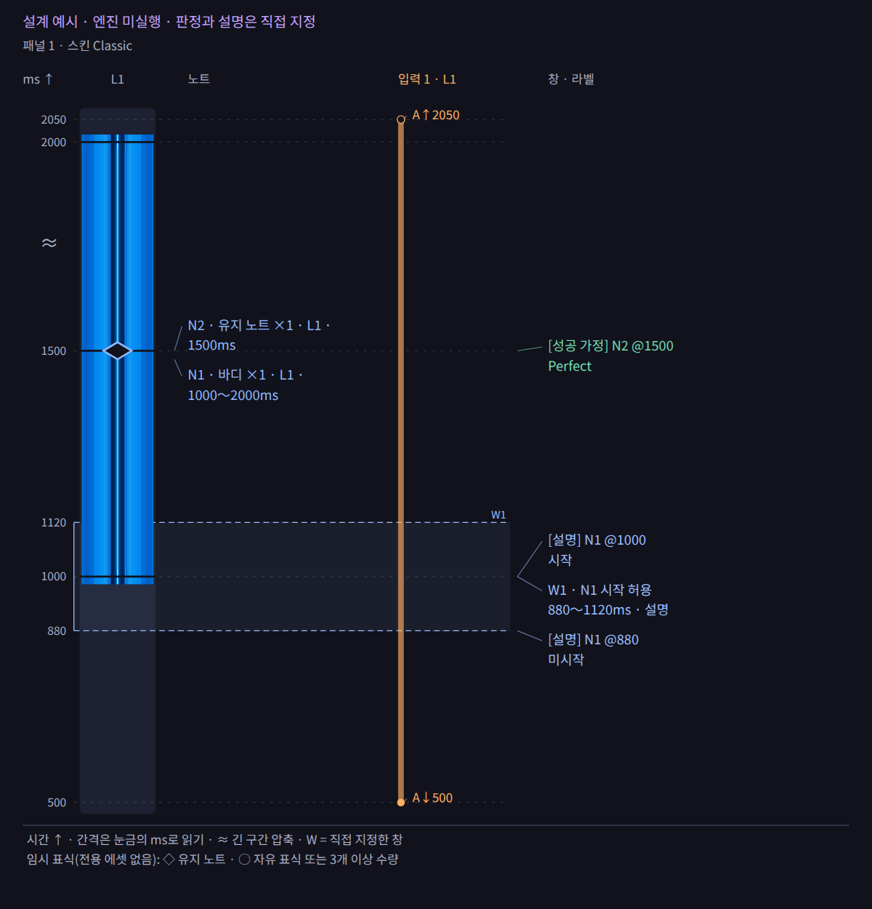

[설계 입력 JSON](fixtures/explicit-note-cases/enj-01.json)

노트: N1 L1 바디 ×1 1000～2000ms; N2 L1 유지 노트 ×1 1500ms.

입력: L1 A↓500 → A↑2050.

기대 진행·효과:

- N1, 880ms: A는 창 전부터 눌렸으므로 창 개방만으로 시작하지 않는다.
- N1, 1000ms: A의 hold로 차트상 시작 시각에 시작한다.
- N2, 1500ms: N2를 표식 시각에 Perfect 3점·가중치 3으로 정산한다.

기대 정산: N1은 무점수, N2만 3/3점·콤보 +1·일반 Perfect 고도 기여·Perfect 글자·레인 타격 이펙트, 타이밍 없음. N1은 2000ms 정상 완료하며 릴리즈 요구를 만들지 않는다.

근거: [RFD 0037 §3-1·§5·§7](../rfd/0037-explicit-score-notes-and-body.md) / 논의 [§5](../research/explicit-score-notes-discussion.md#5-미리-누른-키의-시작-시각)·[§56](../research/explicit-score-notes-discussion.md#56-유지-노트의-독립-허용-창과-선판정-폐지)·[§62](../research/explicit-score-notes-discussion.md#62-유지-노트-성공은-표식-하나당-콤보-증가)·[§63](../research/explicit-score-notes-discussion.md#63-유지-노트-성공도-일반-perfect처럼-고도-계산에-참여)·[§101](../research/explicit-score-notes-discussion.md#101-유지-노트-성공에도-perfect-판정-글자-표시)～[§103](../research/explicit-score-notes-discussion.md#103-유지-노트-성공에도-일반-레인-타격-이펙트-표시).

<a id="enj-02"></a>
## ENJ-02 — 창 안 fresh down은 900ms부터 시작

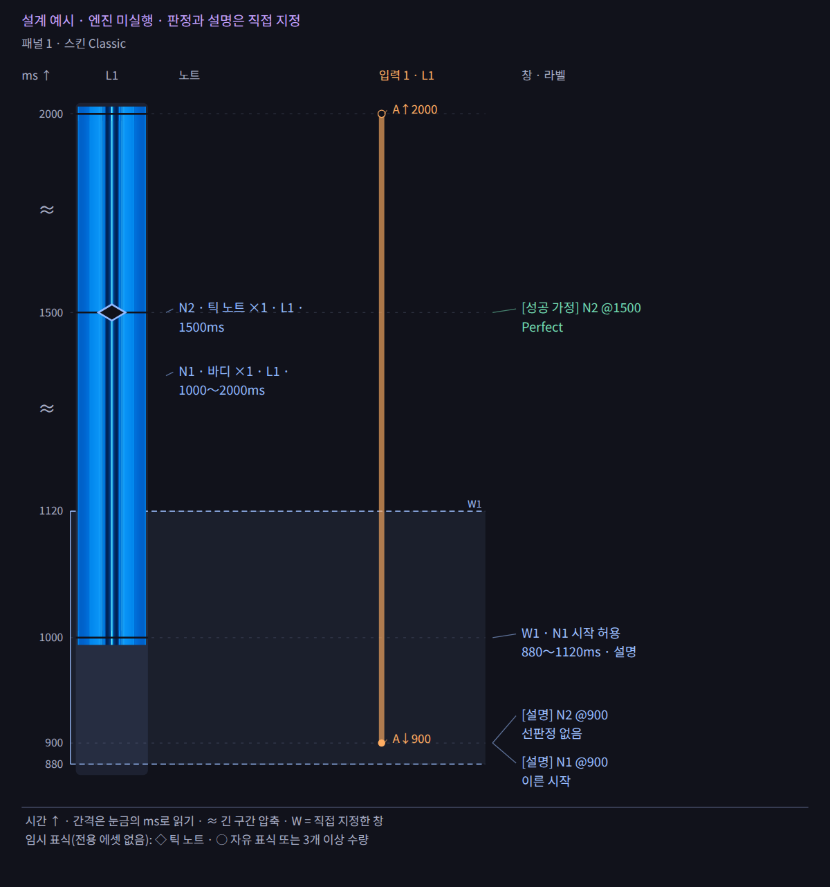

[설계 입력 JSON](fixtures/explicit-note-cases/enj-02.json)

노트: N1 L1 바디 ×1 1000～2000ms; N2 L1 유지 노트 ×1 1500ms.

입력: L1 A↓900 → A↑2000.

기대 진행·효과:

- N1, 900ms: 창 안 새 down으로 시작하며 바디는 down을 소비하지 않는다.
- N2, 900ms: 이른 시작만으로 미래 N2를 성공시키지 않는다.
- N2, 1500ms: 표식 시각의 정상 바디 상태로 N2만 3/3점 정산한다.

기대 정산: N1 실제 시작은 900ms, N2 성공은 1500ms다. N2 성공 효과는 각 1회이며 유지 노트 전용 창·입력 소비는 없다.

근거: [RFD 0037 §3-1·§5](../rfd/0037-explicit-score-notes-and-body.md) / 논의 [§6](../research/explicit-score-notes-discussion.md#6-창-안에서-새로-누르면-그-순간부터-시작)·[§16](../research/explicit-score-notes-discussion.md#16-double의-시작과-짧은-바디의-끝-창-안-down)·[§36](../research/explicit-score-notes-discussion.md#36-바디와-같은-판정과-유지-노트의-입력-미소비)·[§56](../research/explicit-score-notes-discussion.md#56-유지-노트의-독립-허용-창과-선판정-폐지).

<a id="enj-03"></a>
## ENJ-03 — 실제 이른 시작 뒤 차트 시작 전 정상 종료

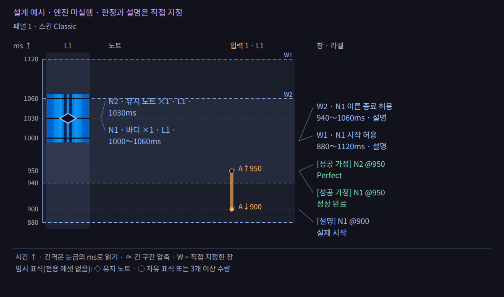

[설계 입력 JSON](fixtures/explicit-note-cases/enj-03.json)

노트: N1 L1 바디 ×1 1000～1060ms; N2 L1 유지 노트 ×1 1030ms.

입력: L1 A↓900 → A↑950.

기대 진행·효과:

- N1, 900ms: 900ms는 시작 창 안이므로 실제 시작한다.
- N1, 950ms: 950ms는 이미 시작한 N1의 끝 이른 창 안이다.
- N2, 950ms: N1 정상 종료에 속한 미처리 N2를 함께 Perfect로 정산한다.

기대 정산: N1은 950ms에 무점수 정상 완료·숨김. N2는 3/3점·콤보 +1 및 일반 Perfect 성공 효과를 한 번 받고 숨는다. 릴리즈·FAST/SLOW는 없다.

근거: [RFD 0037 §3-2·§5·§7](../rfd/0037-explicit-score-notes-and-body.md) / 논의 [§7](../research/explicit-score-notes-discussion.md#7-이른-뗌은-바디가-이미-시작한-상태를-전제로-함)·[§35](../research/explicit-score-notes-discussion.md#35-유지-노트-허용-창-공유와-good-예외-제거)·[§56](../research/explicit-score-notes-discussion.md#56-유지-노트의-독립-허용-창과-선판정-폐지)·[§79](../research/explicit-score-notes-discussion.md#79-정상-완료된-바디는-연결-여부와-관계없이-즉시-숨김).

<a id="enj-04"></a>
## ENJ-04 — preheld를 950ms에 떼면 미시작 완료 불가

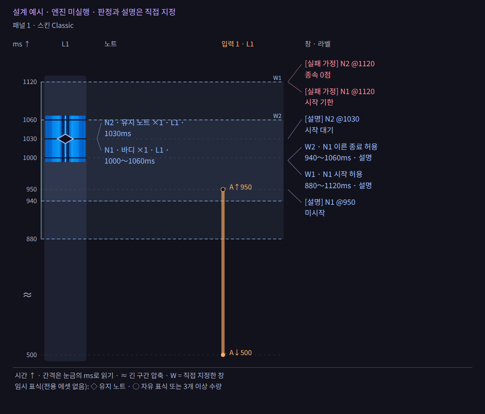

[설계 입력 JSON](fixtures/explicit-note-cases/enj-04.json)

노트: N1 L1 바디 ×1 1000～1060ms; N2 L1 유지 노트 ×1 1030ms.

입력: L1 A↓500 → A↑950.

기대 진행·효과:

- N1, 950ms: 시작 창 전 down을 차트상 시작 전에 떼었으므로 N1은 시작하지 않았다. 끝 창 안 up만으로 완료하지 않는다.
- N2, 1030ms: N1의 최초 시작 판단이 남아 있어 N2는 대기한다.
- N1, 1120ms: 1120ms 시작 기한을 넘기면 시작 실패. 950ms up 자체가 즉시 실패를 만드는 것은 아니다.
- N2, 1120ms: 시작 실패 확정 시 N2를 0점·원래 가중치 3으로 정산하고 추가 Miss 효과는 만들지 않는다.

기대 정산: N1의 시작 실패 한 번과 N2의 종속 0점(0/3점). N2에 새 Miss 글자·성공 효과·타이밍을 만들지 않는다. 실패 확정 시각은 엔진 실측값이 아니다.

근거: [RFD 0037 §3-1·§3-2·§4·§5](../rfd/0037-explicit-score-notes-and-body.md) / 논의 [§5](../research/explicit-score-notes-discussion.md#5-미리-누른-키의-시작-시각)·[§7](../research/explicit-score-notes-discussion.md#7-이른-뗌은-바디가-이미-시작한-상태를-전제로-함)·[§17](../research/explicit-score-notes-discussion.md#17-바디에-연결된-릴리즈는-실제-시작이-전제)·[§56](../research/explicit-score-notes-discussion.md#56-유지-노트의-독립-허용-창과-선판정-폐지).

<a id="enj-05"></a>
## ENJ-05 — 15ms 안 회복하면 대기한 유지 노트 Perfect

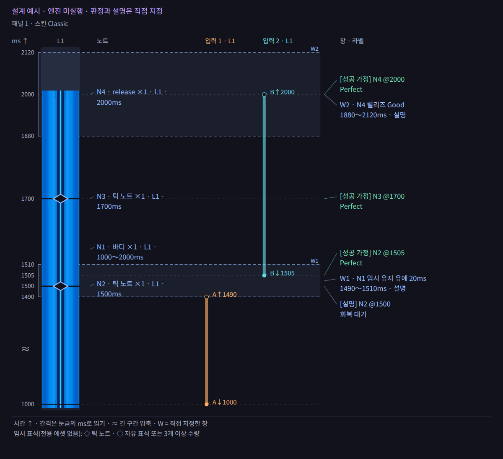

[설계 입력 JSON](fixtures/explicit-note-cases/enj-05.json)

노트: N1 L1 바디 ×1 1000～2000ms; N2 L1 유지 노트 ×1 1500ms; N3 L1 유지 노트 ×1 1700ms; N4 L1 릴리즈 ×1 2000ms.

입력: L1 A↓1000 → A↑1490; L1 B↓1505 → B↑2000.

기대 진행·효과:

- N2, 1500ms: N2 시각에 hold가 부족하지만 유지 유예 중이므로 성공·실패를 확정하지 않는다.
- N2, 1505ms: 15ms 공백 뒤 유효 회복으로 N2를 Perfect 정산한다.
- N3, 1700ms: N3는 정상 유지 중 표식 시각에 Perfect.
- N4, 2000ms: B up으로 명시 N4를 Perfect 정산한다.

기대 정산: 세 점수 항목 9/9점·성공 콤보 기여 3회·Miss 없음. N2는 1500ms에 효과를 내지 않고 1505ms 성공 확정에 일반 Perfect 고도·글자·레인 타격을 낸다. 유지 타이밍은 없다.

근거: [RFD 0037 §3-1·§5·§7](../rfd/0037-explicit-score-notes-and-body.md) / 논의 [§32](../research/explicit-score-notes-discussion.md#32-회복-대기와-이른-종료-시-유지-노트-정산)·[§35](../research/explicit-score-notes-discussion.md#35-유지-노트-허용-창-공유와-good-예외-제거)·[§56](../research/explicit-score-notes-discussion.md#56-유지-노트의-독립-허용-창과-선판정-폐지)·[§62](../research/explicit-score-notes-discussion.md#62-유지-노트-성공은-표식-하나당-콤보-증가)·[§63](../research/explicit-score-notes-discussion.md#63-유지-노트-성공도-일반-perfect처럼-고도-계산에-참여)·[§101](../research/explicit-score-notes-discussion.md#101-유지-노트-성공에도-perfect-판정-글자-표시)～[§103](../research/explicit-score-notes-discussion.md#103-유지-노트-성공에도-일반-레인-타격-이펙트-표시).

<a id="enj-06"></a>
## ENJ-06 — 유예 뒤 재누름은 실패와 종속 0점을 복구하지 않음

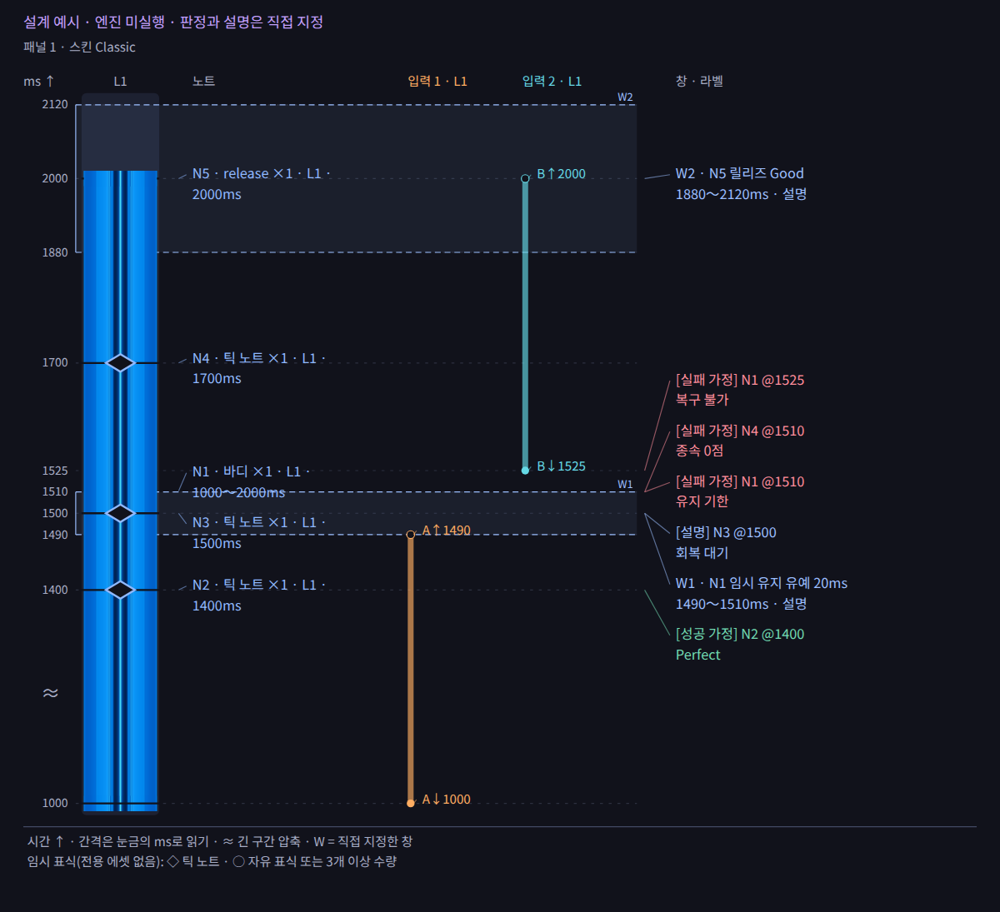

[설계 입력 JSON](fixtures/explicit-note-cases/enj-06.json)

노트: N1 L1 바디 ×1 1000～2000ms; N2 L1 유지 노트 ×1 1400ms; N3 L1 유지 노트 ×1 1500ms; N4 L1 유지 노트 ×1 1700ms; N5 L1 릴리즈 ×1 2000ms.

입력: L1 A↓1000 → A↑1490; L1 B↓1525 → B↑2000.

기대 진행·효과:

- N2, 1400ms: 이미 성공한 N2는 3점·가중치 3을 유지한다.
- N3, 1500ms: N3를 즉시 성공시키지 않고 회복 결과를 기다린다.
- N1, 1510ms: 1510ms 유지 기한을 넘겨 회복하지 못하면 N1 유지 실패 한 번.
- N4, 1510ms: N3·N4·N5의 미처리 기회가 닫히면 각각 0점·원래 가중치 3으로 정산한다.
- N1, 1525ms: 뒤 B down/up은 N1이나 닫힌 점수 항목을 복구하지 않는다.

기대 정산: 이미 성공한 N2의 3점은 남아 전체 3/12점. 원인 유지 Miss·콤보 단절·고도 손실만 한 번이며 종속 세 항목에 추가 실패 효과·FAST/SLOW는 없다. 실패한 미래 표식·릴리즈는 실패색으로 남는다.

근거: [RFD 0037 §4·§5·§7](../rfd/0037-explicit-score-notes-and-body.md) / 논의 [§32](../research/explicit-score-notes-discussion.md#32-회복-대기와-이른-종료-시-유지-노트-정산)·[§35](../research/explicit-score-notes-discussion.md#35-유지-노트-허용-창-공유와-good-예외-제거)·[§56](../research/explicit-score-notes-discussion.md#56-유지-노트의-독립-허용-창과-선판정-폐지)·[§70](../research/explicit-score-notes-discussion.md#70-실패한-릴리즈는-실패색으로-화면-밖까지-남김)·[§75](../research/explicit-score-notes-discussion.md#75-바디-탈락으로-종속-0점인-미래-유지-표식은-실패색)·[§81](../research/explicit-score-notes-discussion.md#81-실패한-바디는-실패색으로-스크롤-밖까지-남김).

<a id="enj-07"></a>
## ENJ-07 — Good 릴리즈와 남은 유지 두 개의 Perfect 일괄 정산

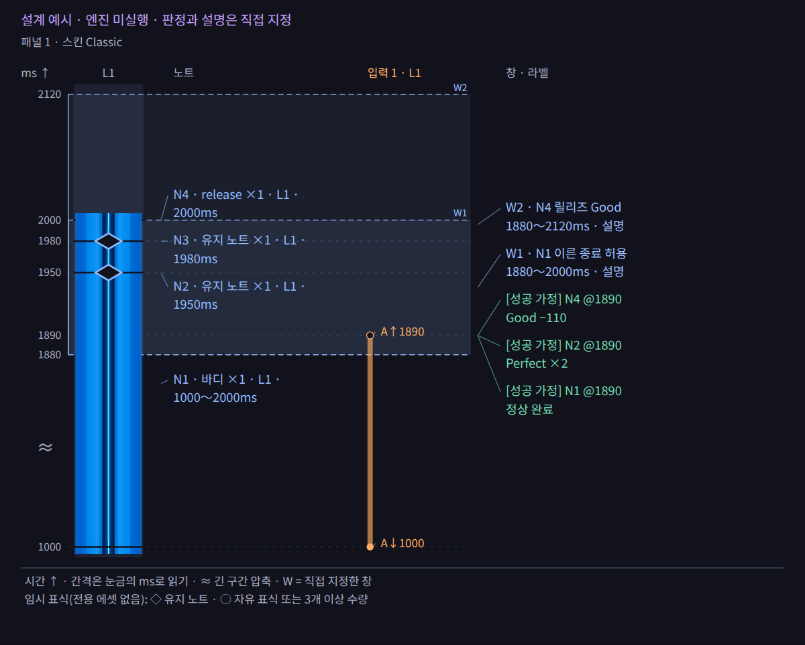

[설계 입력 JSON](fixtures/explicit-note-cases/enj-07.json)

노트: N1 L1 바디 ×1 1000～2000ms; N2 L1 유지 노트 ×1 1950ms; N3 L1 유지 노트 ×1 1980ms; N4 L1 릴리즈 ×1 2000ms.

입력: L1 A↓1000 → A↑1890.

기대 진행·효과:

- N1, 1890ms: N1은 끝의 이른 허용 범위에서 정상 완료·즉시 숨김.
- N2, 1890ms: 그 종료의 남은 N2·N3를 각각 Perfect 3점으로 정산한다.
- N4, 1890ms: N4는 별도로 Good 1점, raw 오차 −110ms다.

기대 정산: 유지 6점 + 릴리즈 1점 = 7/9점, 성공 콤보 기여 3회. 유지에는 타이밍을 만들지 않는다. 같은 확정 시각 대표 글자는 Good·FAST −110ms이며 각 유지 성공의 고도·레인 타격 효과는 보존한다.

근거: [RFD 0037 §3-2·§5·§7](../rfd/0037-explicit-score-notes-and-body.md) / 논의 [§34](../research/explicit-score-notes-discussion.md#34-릴리즈-창-확대-철회와-누름-창-공유)·[§35](../research/explicit-score-notes-discussion.md#35-유지-노트-허용-창-공유와-good-예외-제거)·[§56](../research/explicit-score-notes-discussion.md#56-유지-노트의-독립-허용-창과-선판정-폐지)·[§62](../research/explicit-score-notes-discussion.md#62-유지-노트-성공은-표식-하나당-콤보-증가)·[§63](../research/explicit-score-notes-discussion.md#63-유지-노트-성공도-일반-perfect처럼-고도-계산에-참여)·[§79](../research/explicit-score-notes-discussion.md#79-정상-완료된-바디는-연결-여부와-관계없이-즉시-숨김)·[§101](../research/explicit-score-notes-discussion.md#101-유지-노트-성공에도-perfect-판정-글자-표시)～[§104](../research/explicit-score-notes-discussion.md#104-같은-대표-등급의-타이밍-표시는-실제-입력의-큰-절대-오차-우선).

<a id="enj-08"></a>
## ENJ-08 — Grace 릴리즈도 실제 up을 요구하고 유지 성공은 Perfect

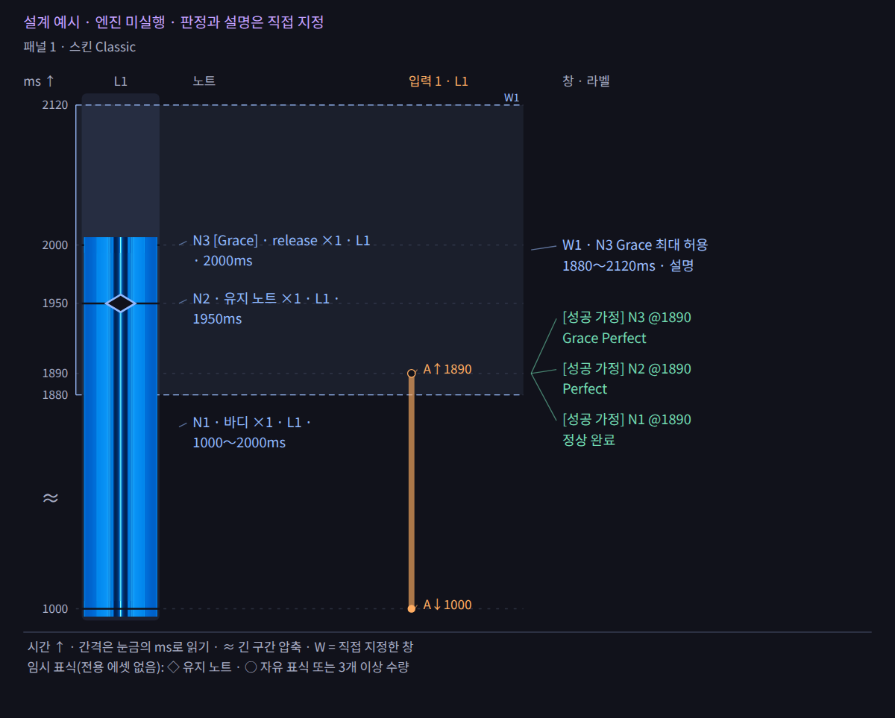

[설계 입력 JSON](fixtures/explicit-note-cases/enj-08.json)

노트: N1 L1 바디 ×1 1000～2000ms; N2 L1 유지 노트 ×1 1950ms; N3(Grace) L1 릴리즈 ×1 2000ms.

입력: L1 A↓1000 → A↑1890.

기대 진행·효과:

- N1, 1890ms: 실제 up으로 N1이 이른 정상 완료한다.
- N2, 1890ms: 남은 N2를 Perfect로 일괄 정산한다.
- N3, 1890ms: N3는 같은 Good 최대 창 안의 실제 up으로 Perfect다.

기대 정산: N2·N3는 6/6점·콤보 기여 2회이며 둘 다 타이밍 표시·FAST/SLOW를 만들지 않는다. Grace 이름은 수동 의미 지정이며 현행 차트 포맷/엔진 지원의 증거가 아니다.

근거: [RFD 0037 §2·§3-2·§5·§7](../rfd/0037-explicit-score-notes-and-body.md) / 논의 [§13](../research/explicit-score-notes-discussion.md#13-일반grace-릴리즈의-최대-허용-창-공유)·[§34](../research/explicit-score-notes-discussion.md#34-릴리즈-창-확대-철회와-누름-창-공유)·[§35](../research/explicit-score-notes-discussion.md#35-유지-노트-허용-창-공유와-good-예외-제거)·[§56](../research/explicit-score-notes-discussion.md#56-유지-노트의-독립-허용-창과-선판정-폐지).

<a id="enj-09"></a>
## ENJ-09 — 바디 완료 뒤 계속 누르면 Grace 릴리즈만 Miss

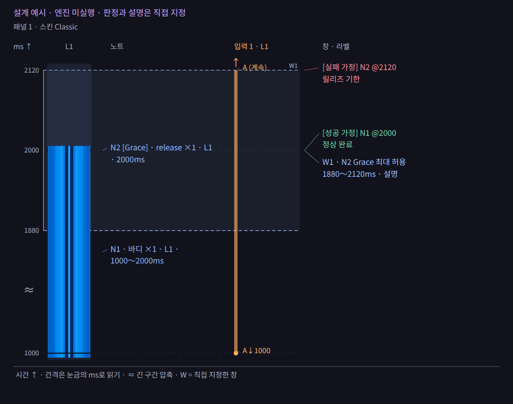

[설계 입력 JSON](fixtures/explicit-note-cases/enj-09.json)

노트: N1 L1 바디 ×1 1000～2000ms; N2(Grace) L1 릴리즈 ×1 2000ms.

입력: L1 A↓1000 → 계속 누름.

기대 진행·효과:

- N1, 2000ms: N1은 끝까지 유지했으므로 2000ms에 무점수 완료·숨김. N2는 별도로 대기한다.
- N2, 2120ms: 2120ms 포함 창을 넘겨도 up이 없으면 N2만 Miss. 완료한 N1에 유지 실패를 추가하지 않는다.

기대 정산: N2 0/3점·릴리즈 Miss 한 번, Grace는 hold만으로 성공하지 않는다. 실패 N2와 Grace 외곽은 스크롤 밖까지 남고 외곽 밝기는 본체 alpha와 분리한다.

근거: [RFD 0037 §2·§3-2·§7](../rfd/0037-explicit-score-notes-and-body.md) / 논의 [§8](../research/explicit-score-notes-discussion.md#8-정상-유지-완료와-릴리즈-대기의-분리)·[§13](../research/explicit-score-notes-discussion.md#13-일반grace-릴리즈의-최대-허용-창-공유)·[§70](../research/explicit-score-notes-discussion.md#70-실패한-릴리즈는-실패색으로-화면-밖까지-남김)·[§78](../research/explicit-score-notes-discussion.md#78-grace-릴리즈-외곽은-본체가-보이는-동안-유지)·[§79](../research/explicit-score-notes-discussion.md#79-정상-완료된-바디는-연결-여부와-관계없이-즉시-숨김).

<a id="enj-10"></a>
## ENJ-10 — 삭제

ENJ-10은 금지 배치(경계에 Point도 릴리즈도 없는 같은 hold 수 바디 연결)를 다뤄 2026-10-27에 삭제했다. 번호는 비워 둔다. 근거는 [RFD 0037 §6-1](../rfd/0037-explicit-score-notes-and-body.md#6-1-배치와-소속)이다.

<a id="enj-11"></a>
## ENJ-11 — 1→2는 앞 single 탈락 뒤 두 몫 모두 새 시작

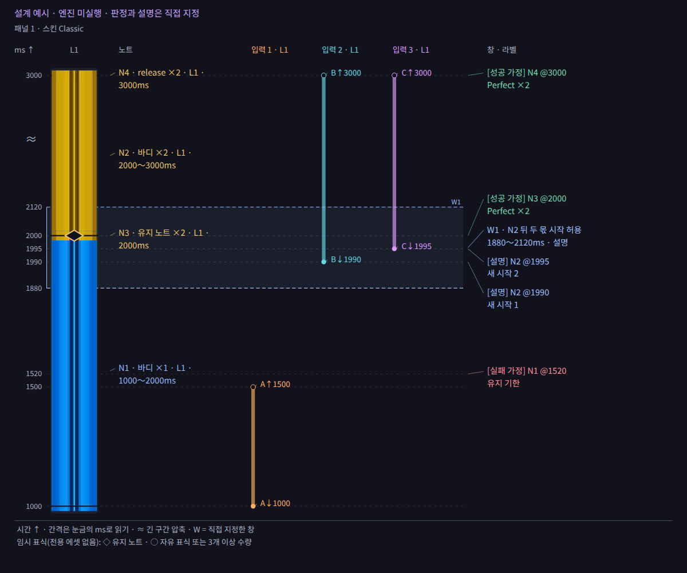

[설계 입력 JSON](fixtures/explicit-note-cases/enj-11.json)

노트: N1 L1 바디 ×1 1000～2000ms; N2 L1 바디 ×2 2000～3000ms; N3 L1 유지 노트 ×2 2000ms; N4 L1 릴리즈 ×2 3000ms.

입력: L1 A↓1000 → A↑1500; L1 B↓1990 → B↑3000; L1 C↓1995 → C↑3000.

기대 진행·효과:

- N1, 1520ms: 앞 N1의 확정 실패는 남는다.
- N2, 1990ms: B down으로 충족한 첫 몫을 시작한다.
- N2, 1995ms: C down으로 서로 다른 두 키의 요구를 채운다.
- N3, 2000ms: N3의 두 표식은 앞 N1이 아니라 뒤 N2 상태를 따른다.
- N4, 3000ms: 서로 다른 B·C up으로 명시 릴리즈 두 항목을 처리한다.

기대 정산: 뒤 점수 네 항목은 12/12점이고 N1의 무점수 실패는 남아 Full Combo가 아니다. 증가의 표식은 뒤 double 기준이며 앞 실패/이른 종료 정산에 넣지 않는다.

근거: [RFD 0037 §3-1·§4·§5·§6-1](../rfd/0037-explicit-score-notes-and-body.md) / 논의 [§20](../research/explicit-score-notes-discussion.md#20-head-없는-12의-추가-몫-시작-시각)·[§21](../research/explicit-score-notes-discussion.md#21-이어진-바디를-나누어-읽는-연주)·[§47](../research/explicit-score-notes-discussion.md#47-12-증가-경계의-뒤-double-전체-새-시작-유지)·[§51](../research/explicit-score-notes-discussion.md#51-12-증가-위치의-유지-노트는-뒤-double-기준)·[§57](../research/explicit-score-notes-discussion.md#57-같은-hold-수의-유지-노트-연결-금지와-증가감소-위치-허용).

<a id="enj-12"></a>
## ENJ-12 — 2→1 일부 실패는 건강한 몫 승계와 감소 릴리즈 종속 0점

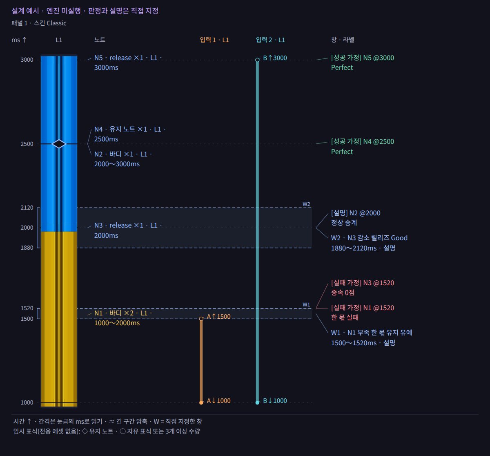

[설계 입력 JSON](fixtures/explicit-note-cases/enj-12.json)

노트: N1 L1 바디 ×2 1000～2000ms; N2 L1 바디 ×1 2000～3000ms; N3 L1 릴리즈 ×1 2000ms; N4 L1 유지 노트 ×1 2500ms; N5 L1 릴리즈 ×1 3000ms.

입력: L1 A↓1000 → A↑1500; L1 B↓1000 → B↑3000.

기대 진행·효과:

- N1, 1520ms: 한 몫 유지 기한을 넘겨 실패해도 건강한 몫을 함께 실패시키지 않는다.
- N3, 1520ms: 명시 감소 릴리즈 N3는 실패한 몫에 귀속되어 0점·가중치 3이다. 실패 기회 소멸의 귀속을 뜻하며 실제 확정 프레임을 지정하지 않는다.
- N2, 2000ms: 건강한 몫을 N2로 이어준다.
- N4, 2500ms: N4는 뒤 N2의 정상 유지로 성공한다.
- N5, 3000ms: B up은 건강한 뒤 몫의 N5를 처리한다.

기대 정산: N3 0점 + N4·N5 6점 = 6/9점. 원인 한 몫 실패 효과만 남고 N3의 추가 Miss는 없다. 전체 double 끝의 단일 릴리즈 기회 보존과 구분한다.

근거: [RFD 0037 §4·§5](../rfd/0037-explicit-score-notes-and-body.md) / 논의 [§11](../research/explicit-score-notes-discussion.md#11-double-바디에-릴리즈-한-몫이-있을-때의-일부-유지-실패)·[§19](../research/explicit-score-notes-discussion.md#19-21-감소의-일부-실패와-릴리즈-귀속)·[§48](../research/explicit-score-notes-discussion.md#48-point-없는-21-감소에서-두-몫-탈락-시-뒤-single도-탈락-유지)·[§98](../research/explicit-score-notes-discussion.md#98-21-감소의-예시는-싱글-릴리즈이며-잘못-확대한-질문을-철회). §48 중 두 몫이 모두 탈락하면 뒤 single도 탈락을 유지한다는 부분은 [§106](../research/explicit-score-notes-discussion.md#106-point-없는-21에서-두-몫-탈락-뒤-single-새-시작)에서 번복했다. 이 사례가 쓰는 한 몫 실패 시 건강한 몫 승계는 바뀌지 않았다.

<a id="enj-13"></a>
## ENJ-13 — 2→1 전체 탈락 뒤 재누름으로 single이 새로 시작

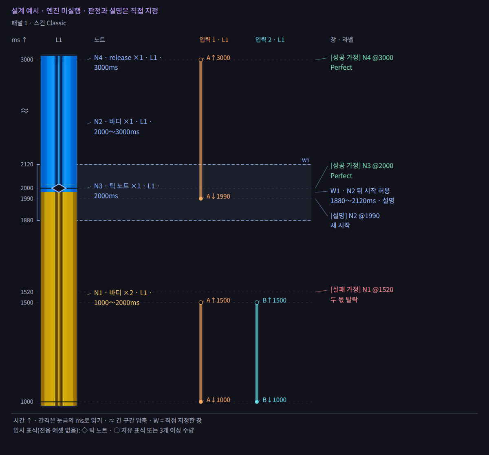

[설계 입력 JSON](fixtures/explicit-note-cases/enj-13.json)

노트: N1 L1 바디 ×2 1000～2000ms; N2 L1 바디 ×1 2000～3000ms; N3 L1 유지 노트 ×1 2000ms; N4 L1 릴리즈 ×1 3000ms.

입력: L1 A↓1000 → A↑1500; L1 B↓1000 → B↑1500; L1 A↓1990 → A↑3000.

기대 진행·효과:

- N1, 1520ms: 두 몫 모두 유지 기한을 넘겨 각각 유지 실패한다. 원인 유지 Miss는 몫마다 하나씩 2개다(사용자 결정, 2026-10-26).
- N2, 1990ms: 앞 N1의 실패를 이어받지 않는다. 시작 창 안의 A 재누름(새 down)으로 뒤 N2가 새로 시작한다(사용자 결정, 2026-10-27).
- N3, 2000ms: 뒤 single 기준인 N3 한 표식은 새로 시작한 N2의 정상 유지로 Perfect.
- N4, 3000ms: A up으로 N4 릴리즈 Perfect.

기대 정산: N3·N4 6/6점. N1 두 몫의 원인 유지 Miss 2개는 남아 Full Combo가 아니며 앞의 확정 실패를 되돌리지 않는다. 감소 위치에 표식 하나만 놓으며 감소 릴리즈를 자동 생성하지 않는다. 표식 자체가 새 시작 지점을 만들지 않고 N2의 시작은 A 재누름에서 온다. 재누름이 없으면 N2는 2120ms 시작 기한을 넘겨 자기 무점수 Miss로 실패하고 N3·N4는 종속 0점이다(기존 시작 규칙의 적용). 라벨은 경계 의미 설명이며 정산 시각 실측이 아니다.

근거: [RFD 0037 §3-1·§4·§5·§6-1](../rfd/0037-explicit-score-notes-and-body.md) / 논의 [§52](../research/explicit-score-notes-discussion.md#52-21-감소-위치의-유지-노트는-뒤-single-기준)·[§56](../research/explicit-score-notes-discussion.md#56-유지-노트의-독립-허용-창과-선판정-폐지)·[§57](../research/explicit-score-notes-discussion.md#57-같은-hold-수의-유지-노트-연결-금지와-증가감소-위치-허용)·[§106](../research/explicit-score-notes-discussion.md#106-point-없는-21에서-두-몫-탈락-뒤-single-새-시작). 이전 기대값(뒤 single 탈락 유지, 0/6점)의 근거였던 [§48](../research/explicit-score-notes-discussion.md#48-point-없는-21-감소에서-두-몫-탈락-시-뒤-single도-탈락-유지)은 §106에서 번복했다.

<a id="enj-14"></a>
## ENJ-14 — 건강한 승계는 짧은 바디 Point 미처리여도 1000ms 시작

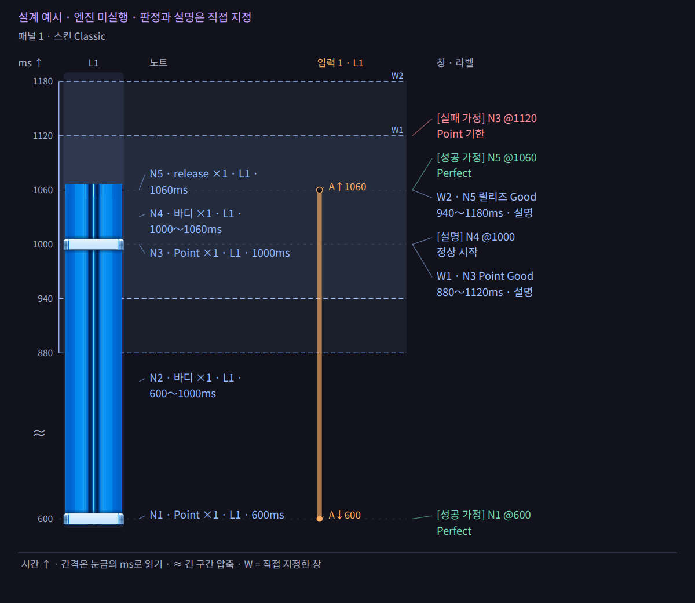

[설계 입력 JSON](fixtures/explicit-note-cases/enj-14.json)

노트: N1 L1 Point ×1 600ms; N2 L1 바디 ×1 600～1000ms; N3 L1 Point ×1 1000ms; N4 L1 바디 ×1 1000～1060ms; N5 L1 릴리즈 ×1 1060ms.

입력: L1 A↓600 → A↑1060.

기대 진행·효과:

- N1, 600ms: N1 Point를 실제 down으로 처리한다.
- N4, 1000ms: N2를 건강하게 유지한 A가 N4를 차트상 시작에 시작시킨다.
- N5, 1060ms: 이미 시작한 N4의 실제 up으로 N5를 처리한다. 숨은 연결 up 소비는 없다.
- N3, 1120ms: N3에 새 down이 없으므로 기한을 넘기면 N3 Miss. 건강한 승계·성공 N5를 되돌리지 않는다.

기대 정산: N1·N5 Perfect, N3 Miss라는 규칙 도출 기대값으로 6/9점. N4를 Point 대기 때문에 미시작으로 처리하거나 추가 유지·릴리즈 Miss를 만들지 않는다.

근거: [RFD 0037 §3-1·§3-3·§4](../rfd/0037-explicit-score-notes-and-body.md) / 논의 [§99](../research/explicit-score-notes-discussion.md#99-건강하게-이어받은-바디도-미리-누름-규칙대로-시작) 및 RFD 0032 §5-1의 충돌하지 않는 건강한 승계.

<a id="enj-15"></a>
## ENJ-15 — 싱글 바디 더블 릴리즈도 시작 Point 재누름 예외 적용

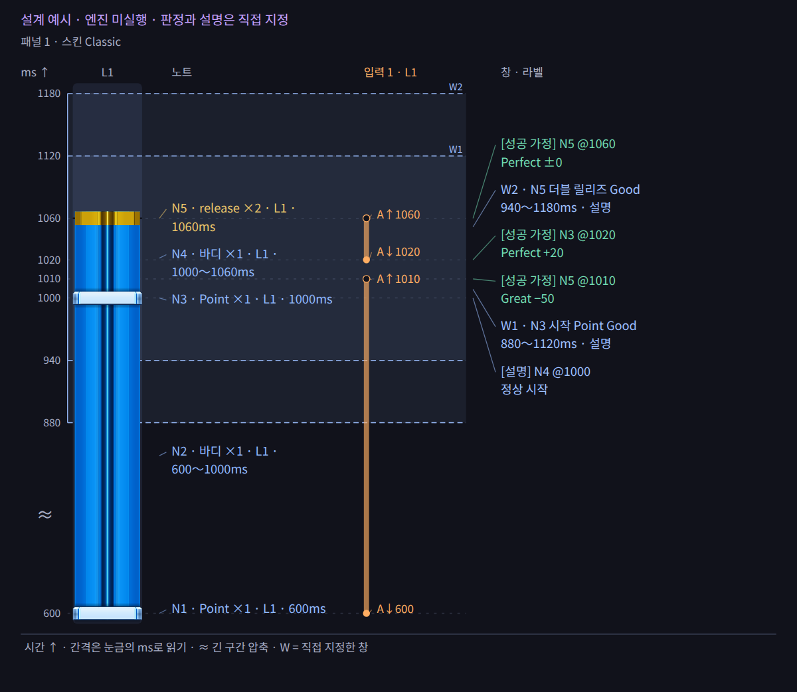

[설계 입력 JSON](fixtures/explicit-note-cases/enj-15.json)

노트: N1 L1 Point ×1 600ms; N2 L1 바디 ×1 600～1000ms; N3 L1 Point ×1 1000ms; N4 L1 바디 ×1 1000～1060ms; N5 L1 릴리즈 ×2 1060ms.

입력: L1 A↓600 → A↑1010; L1 A↓1020 → A↑1060.

기대 진행·효과:

- N4, 1000ms: 건강한 A hold로 N4를 시작한다.
- N5, 1010ms: 첫 A up으로 N4가 정상 완료하고 N5 한 항목을 Great로 정산한다.
- N3, 1020ms: A 재누름이 해당 N4의 시작 Point N3를 실제로 처리한다.
- N5, 1060ms: 그 재누름의 A up은 같은 키여도 N5의 남은 릴리즈를 처리한다.

기대 정산: N1 3점 + N3 3점 + N5 2점·3점 = 11/12점, Miss 없음. 임의 재누름·다른 Point로 예외를 넓히지 않고 완료한 N4의 재시작·추가 점수도 없다.

근거: [RFD 0037 §3-1·§3-3·§7](../rfd/0037-explicit-score-notes-and-body.md) / 논의 [§27](../research/explicit-score-notes-discussion.md#27-재누름-예외-유지와-동시-up의-공동-배정-확인)·[§99](../research/explicit-score-notes-discussion.md#99-건강하게-이어받은-바디도-미리-누름-규칙대로-시작)·[§100](../research/explicit-score-notes-discussion.md#100-시작-point를-처리한-재누름-예외를-싱글-바디의-더블-릴리즈에도-적용).

<a id="enj-16"></a>
## ENJ-16 — 유지 Perfect와 Point Good 동시 확정은 Good 대표

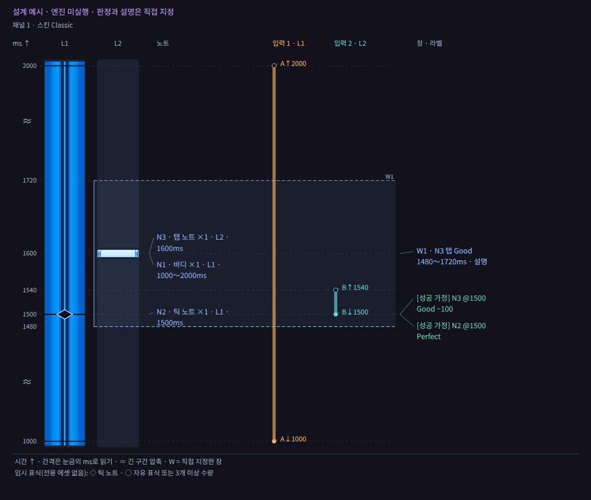

[설계 입력 JSON](fixtures/explicit-note-cases/enj-16.json)

노트: N1 L1 바디 ×1 1000～2000ms; N2 L1 유지 노트 ×1 1500ms; N3 L2 Point ×1 1600ms.

입력: L1 A↓1000 → A↑2000; L2 B↓1500 → B↑1540.

기대 진행·효과:

- N2, 1500ms: N2는 3점·가중치 3, 해당 레인의 일반 Perfect 타격 효과를 갖는다.
- N3, 1500ms: N3는 B down으로 Good 1점·raw −100ms.

기대 정산: 두 항목 4/6점·콤보 기여 2회. 같은 확정 시각 대표 글자는 Good, 표시 타이밍은 N3의 FAST −100ms. 대표 선택이 N2의 개별 성공·고도·레인 타격을 생략하지 않는다.

근거: [RFD 0037 §5·§7](../rfd/0037-explicit-score-notes-and-body.md) / 논의 [§62](../research/explicit-score-notes-discussion.md#62-유지-노트-성공은-표식-하나당-콤보-증가)·[§63](../research/explicit-score-notes-discussion.md#63-유지-노트-성공도-일반-perfect처럼-고도-계산에-참여)·[§101](../research/explicit-score-notes-discussion.md#101-유지-노트-성공에도-perfect-판정-글자-표시)～[§104](../research/explicit-score-notes-discussion.md#104-같은-대표-등급의-타이밍-표시는-실제-입력의-큰-절대-오차-우선).

<a id="enj-17"></a>
## ENJ-17 — 같은 Perfect 후보는 표시 가능한 실제 입력의 큰 오차 우선

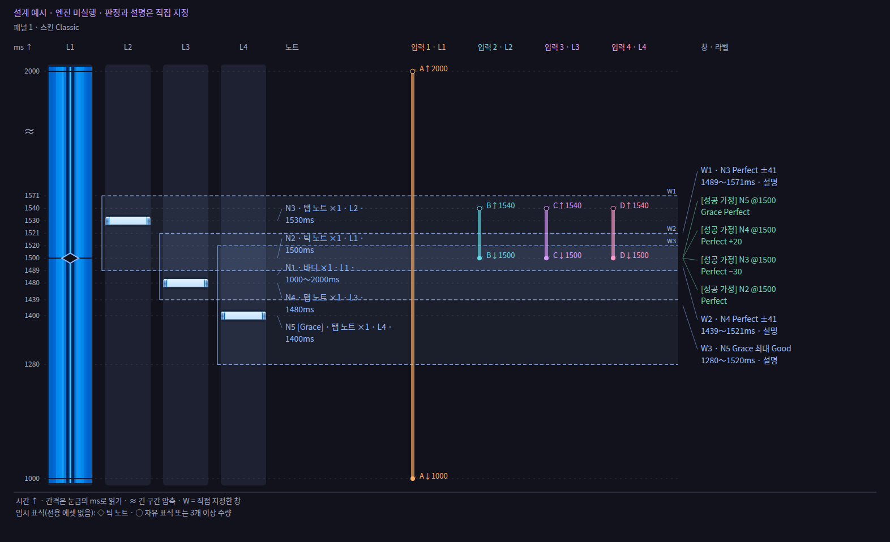

[설계 입력 JSON](fixtures/explicit-note-cases/enj-17.json)

노트: N1 L1 바디 ×1 1000～2000ms; N2 L1 유지 노트 ×1 1500ms; N3 L2 Point ×1 1530ms; N4 L3 Point ×1 1480ms; N5(Grace) L4 Point ×1 1400ms.

입력: L1 A↓1000 → A↑2000; L2 B↓1500 → B↑1540; L3 C↓1500 → C↑1540; L4 D↓1500 → D↑1540.

기대 진행·효과:

- N2, 1500ms: N2의 유지 성공에는 타이밍 정보가 없다.
- N3, 1500ms: N3의 실제 입력 오차는 −30ms다.
- N4, 1500ms: N4는 +20ms로 Perfect이며 기존 20.5ms FAST/SLOW 임계값 안이다.
- N5, 1500ms: N5는 Grace라 raw +100ms의 표시·통계를 만들지 않는다.

기대 정산: 네 점수 항목 12/12점·콤보 기여 4회. 대표는 Perfect·N3의 FAST −30ms이며 N4의 +20ms나 N5의 타이밍을 빌리지 않는다. 항목별 타이밍 통계는 별도로 보존한다.

근거: [RFD 0037 §2·§5·§7](../rfd/0037-explicit-score-notes-and-body.md) / 논의 [§101](../research/explicit-score-notes-discussion.md#101-유지-노트-성공에도-perfect-판정-글자-표시)～[§104](../research/explicit-score-notes-discussion.md#104-같은-대표-등급의-타이밍-표시는-실제-입력의-큰-절대-오차-우선).

<a id="enj-18"></a>
## ENJ-18 — 끝 뒤 유효한 첫 시작은 즉시 바디 완료하고 릴리즈 대기

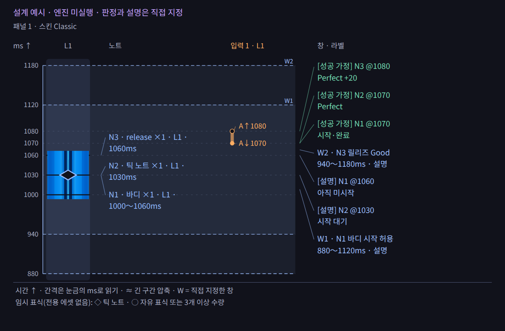

[설계 입력 JSON](fixtures/explicit-note-cases/enj-18.json)

노트: N1 L1 바디 ×1 1000～1060ms; N2 L1 유지 노트 ×1 1030ms; N3 L1 릴리즈 ×1 1060ms.

입력: L1 A↓1070 → A↑1080.

기대 진행·효과:

- N2, 1030ms: 표식 시각에 N1의 최초 시작 판단이 남아 있으므로 N2는 대기한다.
- N1, 1060ms: 끝 시각만으로 N1을 정상 완료하거나 시작 실패로 확정하지 않는다.
- N1, 1070ms: 시작 창 안의 유효한 첫 down으로 시작한 뒤 추가 유지 시간 없이 즉시 완료한다.
- N2, 1070ms: 유효한 늦은 시작으로 대기한 N2를 성공 정산한다.
- N3, 1080ms: 실제 up이 N3를 처리하며 바디 완료만으로 자동 성공시키지 않는다.

기대 정산: N2·N3 6/6점·콤보 기여 2회. N2는 타이밍 없음, N3는 raw +20ms이며 Normal FAST/SLOW 임계값 안이다.

근거: [RFD 0037 §3-2·§5](../rfd/0037-explicit-score-notes-and-body.md) / 논의 [§17](../research/explicit-score-notes-discussion.md#17-바디에-연결된-릴리즈는-실제-시작이-전제)·[§28](../research/explicit-score-notes-discussion.md#28-끝-시각-뒤에-유효하게-시작한-single-바디)·[§56](../research/explicit-score-notes-discussion.md#56-유지-노트의-독립-허용-창과-선판정-폐지).

## 후속 구현 검증의 경계

이 문서는 승인 기대값을 고정한 설계 자료다. 새 모델·컴파일러·세션이 준비되면 각 입력을 실제 판정 테스트로 옮겨 항목 수·등급·소비·실패 비중복·확정 효과·표시 수명을 확인해야 한다. 같은 raw 시각의 키 순서·키 이름·프레임 분할·지연 입력 대조와 AutoPlayer·튜토리얼 반복 통합 검증은 PNG 생성으로 완료되지 않는다. 미정 추적표를 이 문서에 중복하지 않으며 남은 결정·이행 상태는 [PRD §12](../prd.md#12-미정-사항)만 따른다.
